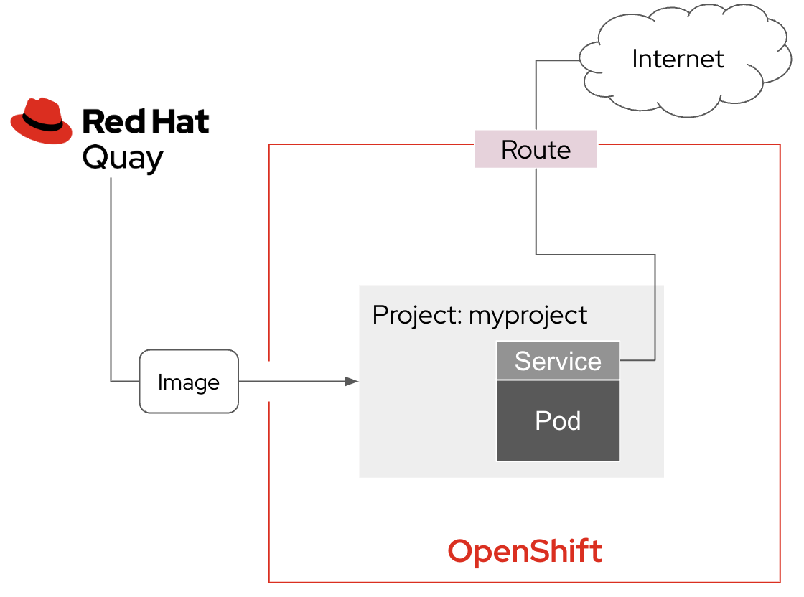
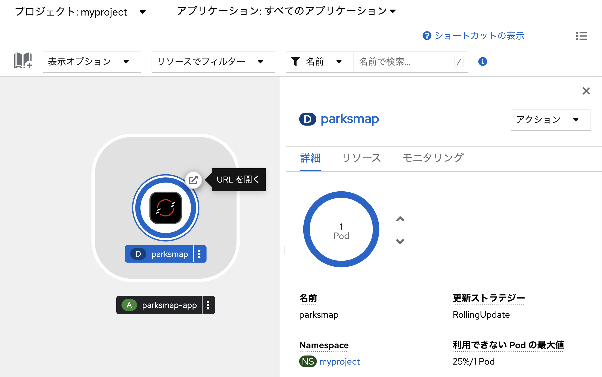
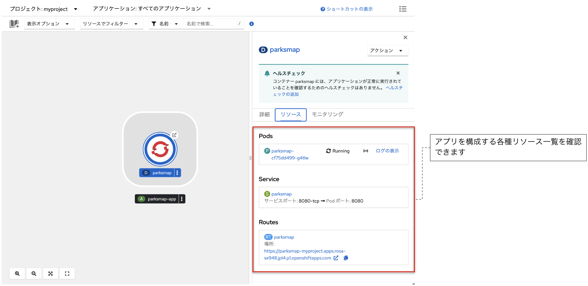
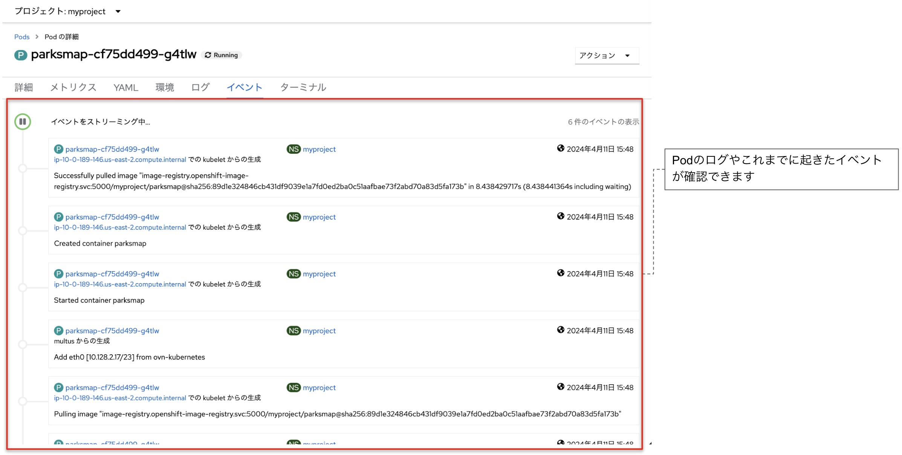

# イメージからアプリケーションをデプロイ
Red Hat Quayに格納されているデモアプリケーションのコンテナイメージから、OpenShiftの特定のProject内にアプリケーションをデプロイしてみます。Kubernetesの各種リソースやログ等も見てみましょう。

**■やることのイメージと大まかな流れ**


- OpenShiftにログインし、Projectを作成する
- アプリ作成を実施
- 各種のログやyamlファイルを見てみる
- デプロイした地図アプリにアクセスしてみる

## Projectを作成しアプリをDeploy
OpenShiftクラスタに「Project」を作成し、その中に事前に用意されたコンテナイメージからアプリケーションをデプロイします。なお、ProjectはNameSpaceと同等のものと考えて頂いて大丈夫です。

### 1. Projectを作成
- ホーム -> 「**プロジェクト**」から「**Projectの作成**」をクリック
- 名前に`myproject`と入力して「**作成**」をクリック

```
myproject
```

- 左メニューの「**Workloads**」->「**トポロジー**」をクリックし、プロジェクト内に何もリソースが無いことを確認

### 2. Quay.ioにあるイメージからアプリをDeploy
- 左の「**+追加**」をクリック
- 「**コンテナイメージ**」をクリック
- 「**外部レジストリーからのイメージ名**」に事前に用意されたコンテナイメージのURLを入力

```
quay.io/openshiftroadshow/parksmap:latest
```

- 他の設定はそのままに「作成」をクリック

### 3. アプリにアクセス
- 「**トポロジー**」の画面に遷移
- 「**Route**」をクリック、アプリにアクセス



### 4. 画面コンソールを確認
アプリを構成する各種リソース一覧を確認できます


Podの詳細画面にて、Podのログやこれまでに起きたイベントが確認できます


## まとめ
事前に用意されたコンテナイメージから簡単にアプリケーションをデプロイし、インターネットに公開することができました。

## 目次へ戻る
[こちら](../README.md)
