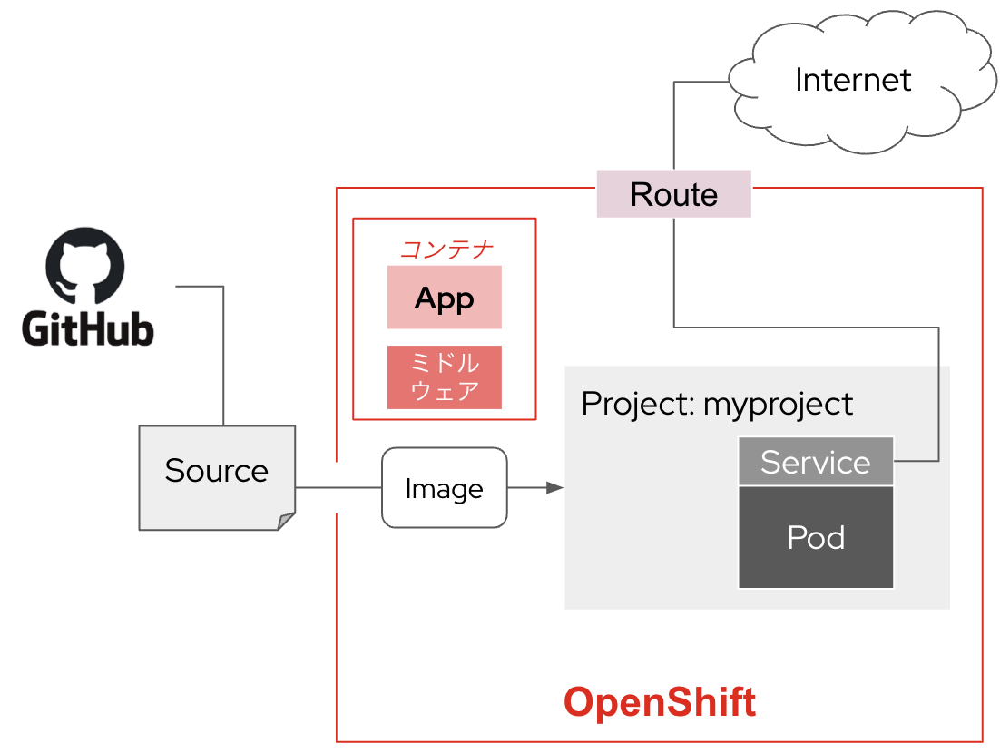
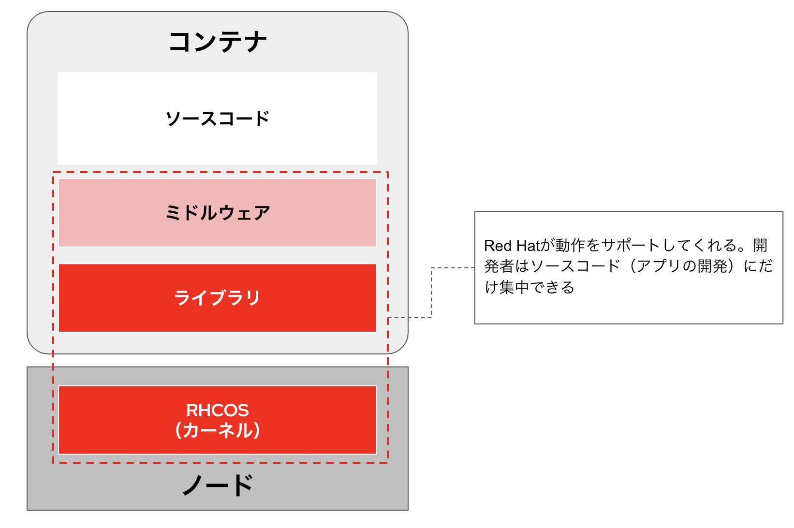
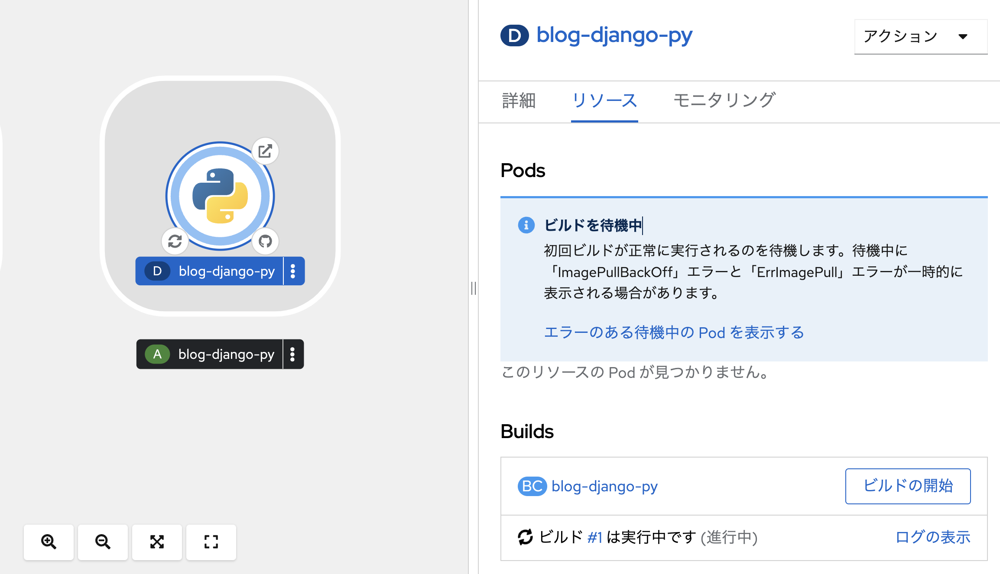
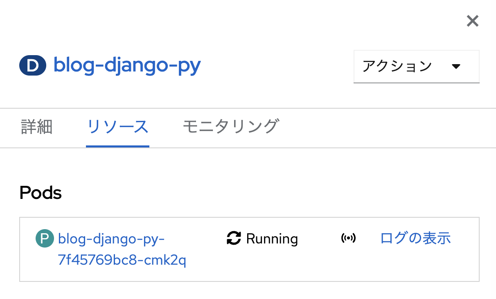
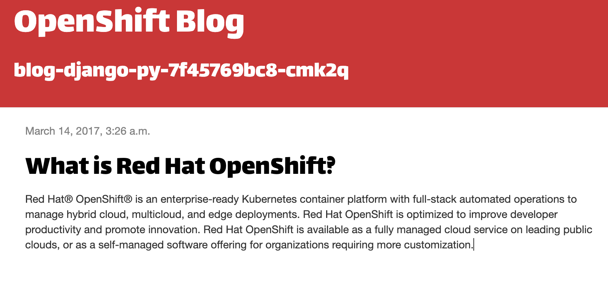
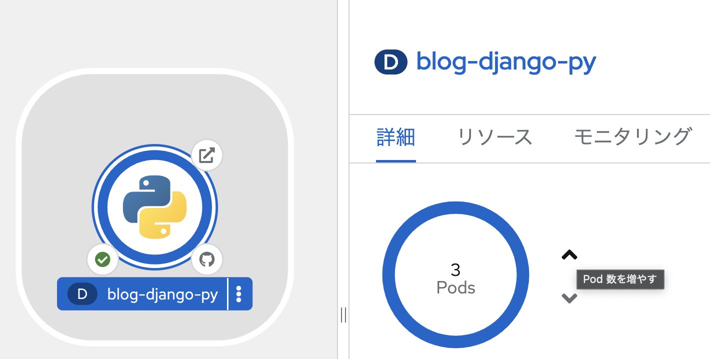
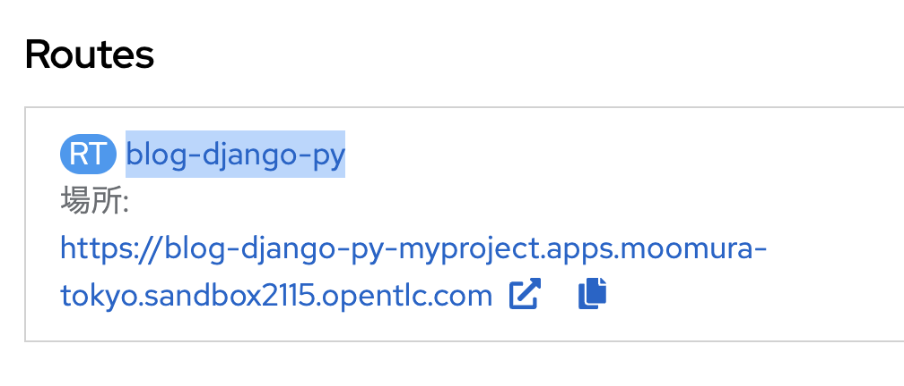
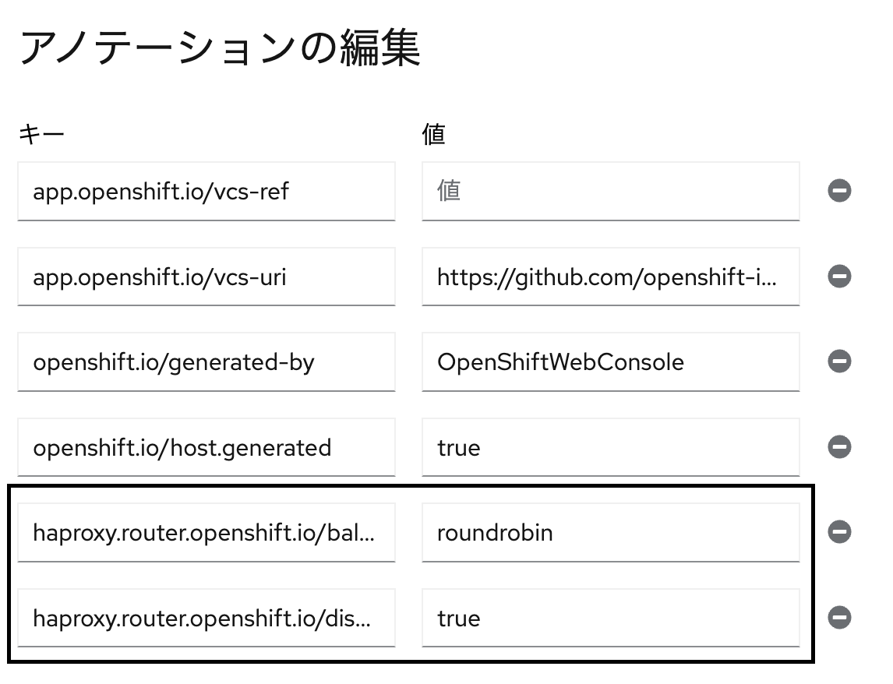

# ソースコードからアプリケーションをデプロイ
GitHubに置いてあるソースコードから、Source to Image (S2I) を利用してOpenShiftの特定のProject内にアプリケーションをデプロイしてみます。S2Iを利用すると、コンテナイメージのビルドをOpenShiftが実施してくれます。また、OpenShiftに用意されたユニバーサル・ベース・イメージ（UBI）を利用してコンテナを作成できます。UBIはRed Hatが提供するベースイメージで、OpenShift上で安心安全にコンテナアプリケーションをデプロイするために利用できます。

**■やることのイメージと大まかな流れ**


- 開発者パースペクティブからアプリ作成（S2I）を実施
- アプリケーションにアクセスする
- Pod数を増やし、Routeにアクセスをロードバランシングさせる

## ソースコードからアプリをDeploy
「**イメージからアプリケーションをデプロイ**」し時と同様に、Project内にリソースを追加します。ただし、今回はGitリポジトリに保存されたソースコードを利用し、S2Iによってアプリケーションをデプロイします。

### GithubにおいてあるソースコードからアプリをDeploy
- NameSpace「**myproject**」を選択
- 左の「**+追加**」をクリック
- 「**Gitからのインポート**」をクリック
- 「**Gitリポジトリー URL**」にGitリポジトリのURLを入力
```
https://github.com/openshift-instruqt/blog-django-py
```
- 「**インポートストラテジーの編集**」をクリック
- 「**Builder Image**」を選択
- 「**Python 3.9 (UBI 8)**」が自動的に選ばれているか確認


- アプリケーションから「**アプリケーショングループの作成**」をクリックし、以下のように入力

```
blog-django-py
```


- 「**作成**」をクリック

---
**■補足：** 今回使うサンプルアプリケーションはPythonで作成された簡単なブログアプリです。Pythonで作成されたアプリを動作するのに必要なライブラリやミドルウェア一式は、Red Hatが提供する「**Python 3.9 (UBI 8)**」に全て含まれています。


RHCOS（Red Hat Enterprise Linux Core OS）は、RHELと共通のカーネルに加え、Kubernetesのノードとして動作するのに必要最小限のライブラリに絞ったOSです。余分なライブラリを持たないことは、OSを軽量化してホストマシンのリソースの有効活用に繋がります。また、脆弱性を孕むリスクを最小化し、アタックサーフェスを減らす効果もあります。

---

### blog-django-pyアプリのリソースを見る
- トポロジー画面から**blog-django-py**アプリのアイコンをクリック
- 「**リソース**」タブをクリック
- 「**ログの表示**」をクリック
    - コンテナイメージをビルドしているログを確認できます



### アプリにアクセス
- 「**トポロジー**」の画面に遷移
- 「**Route**」をクリック、アプリにアクセス

---
**■ 補足：** ブログアプリケーションには、現在アクセスしているPod名が表示されます。



## ラウンドロビン設定
ブログアプリのPodを複数に増やし、アクセス負荷を分散しましょう。また、インターネットからアクセスするたびに各Podにアクセスをラウンドロビンさせます。

### アプリのPod数を増やす
- 「**トポロジー画面**」からblog-django-pyアプリのアイコンをクリック
- 「**詳細**」タブでPod数をお好きな数増やす
- コンテナ（Pod）のインスタンスは仮想マシンに比べて短い時間でスケールアウトすることを確認してください。



### Routeの詳細画面に遷移
- 「**リソース**」タブをクリック
- 「**Route**」欄の「**(RT)blog-django-py**」をクリック



### Routeにラウンドロビンの設定
- 「**アノテーション**」をクリック
「**+追加する**」を2回クリックし、以下2つのkey:valueを追加する

| key | value |設定内容|
| ---- | ---- |---- |
| `haproxy.router.openshift.io/balance` | `roundrobin` |ラウンドロビン方式とする設定
| `haproxy.router.openshift.io/disable_cookies` | `true` |Cookie無効化の設定|

---
※簡単コピペ用
```
haproxy.router.openshift.io/balance
```
```
roundrobin
```
```
haproxy.router.openshift.io/disable_cookies
```
```
true
```

---




- 「**保存**」をクリック
- blog-django-pyアプリ画面を更新して、Pod名が切り替わる事を確認する

## まとめ
S2Iを利用することで、アプリケーションのソースコードから自動的にコンテナイメージをビルドし、デプロイまで実施することができました。また、Routeの設定を変更し、アプリケーションの負荷分散を実現できました。

## 目次へ戻る
[こちら](https://gitlab.com/hikaru-nomura/openshift-handson/-/blob/main/README.md?ref_type=heads)
