# GitOpsを体験
OpenShift GitOpsを利用したGitOpsを体験しましょう。

Kubernetesのあらゆるリソースは「**マニフェスト（Manifest）**」と呼ばれるコードで表現・管理することができます。Manifestは「**YAML**」と呼ばれる形式で記述されます。YAMLはインデントとKey:valueを用いた非常にシンプルな記法ですが、幅広いリソースを表現することができます。

このYAMLファイルをGitリポジトリで管理し、編集結果を自動的にKubernetesクラスタに適用する方法論を「**GitOps**」と言います。Gitリポジトリには変更履歴や証跡管理（誰が、いつ、何を変更したか）が可能な機能があります。**GitOps**の実施は自動化に加えて「**セキュリティ・ガバナンスの確保**」という観点でも必須な、「**Kubernetesにおける開発運用のベストプラクティス**」です。

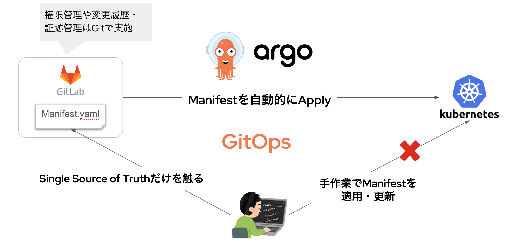

このGitOpsを実現するOSSとして非常に広く使われているのが「**ArgoCD**」です。Gitリポジトリに格納したManifestファイル（Single Source of Truth）を自動的にKubernetesクラスタに適用してくれます。


本パートを通してArgoCDの使い方や機能について基礎を押さえましょう。

## やることのイメージと大まかな流れ
Gitリポジトリに格納されたDeploymentファイルを元にアプリのDeployを自動的に行います。その後、OpenShift側でDeploymentの情報（今回は”環境変数”）を書き換え、Deploymentの不整合を発生→是正を試します。

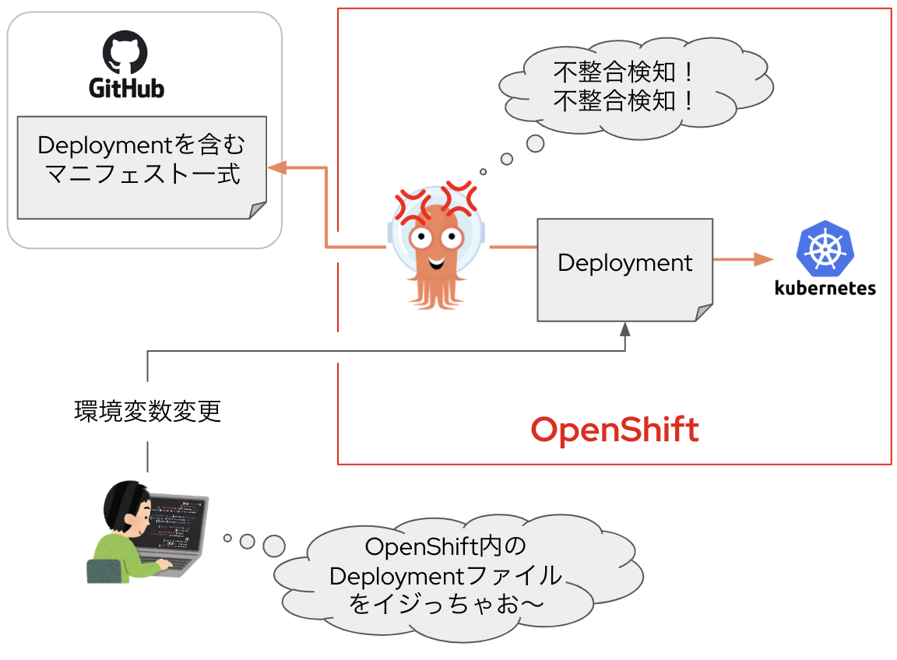

- OpenShift Gitops Operatorをインストールする
- ArgoCDにアクセスし、OpenShiftのSSOでログイン
- サンプルアプリをArgoCDを用いてDeployしてみる
- クラスタ内のDeloymentファイルを手作業でいじって、アプリケーションに変更を発生させる
- 不整合を検知させ、GitリポジトリのDeploymentファイル側を正しいものとして是正する

## デプロイするサンプルアプリケーションを確認

GitHubにアップロードされているサンプルアプリケーション（bgd）のManifest一覧を確認しておきます。
- 以下にアクセス
    - https://github.com/redhat-developer-demos/openshift-gitops-examples/tree/main/apps/bgd/overlays/bgd
- このManifestからデプロイされるアプリケーションは、環境変数で指定された色（color）の泡がプカプカ浮いているアプリです
- アプリケーションを構成するManifestは以下です
    - [bgd-ns.yaml](https://raw.githubusercontent.com/redhat-developer-demos/openshift-gitops-examples/refs/heads/main/apps/bgd/overlays/bgd/bgd-ns.yaml)：アプリをデプロイするNameSpace自体を表したYAML
    - [bgd-deployment.yaml](https://raw.githubusercontent.com/redhat-developer-demos/openshift-gitops-examples/refs/heads/main/apps/bgd/overlays/bgd/bgd-deployment.yaml)：Deploymentファイル。この中で環境変数が定義されている
    - [bgd-svc.yaml](https://raw.githubusercontent.com/redhat-developer-demos/openshift-gitops-examples/refs/heads/main/apps/bgd/overlays/bgd/bgd-svc.yaml)：アプリケーションをクラスタ内に公開する通信窓口を提供するService
    - [bgd-route.yaml](https://raw.githubusercontent.com/redhat-developer-demos/openshift-gitops-examples/refs/heads/main/apps/bgd/overlays/bgd/bgd-route.yaml) ：インターネットに公開するためのRoute

## ArgoCDからManifestを適用してもらう
先ほど確認したManifestをArgoCDアプリケーションからKubernetesクラスタに適用してもらいます。ArgoCDへの指示（ここにこんなManifestを適用してください）を「**ArgoCDアプリケーション**」と言います。ArgoCDアプリケーション自体もYAMLファイルで表現できます。

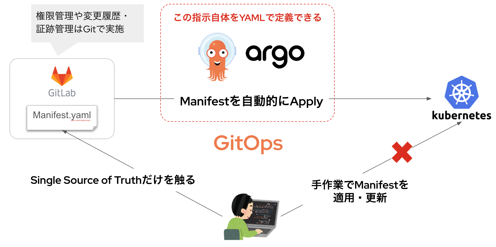

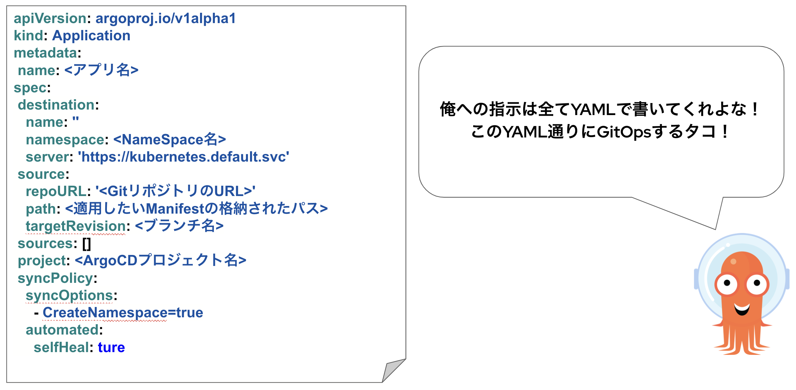

### ArgoCDアプリケーションを適用する


- ArgoCDのログイン後画面にて、左メニュー「**Applications**」をクリック
- 「**+NEW APP**」をクリック
- 「**EDIT AS YAML**」をクリックし、以下のYAMLファイルをコピペする
  ```
  apiVersion: argoproj.io/v1alpha1
kind: Application
metadata:
  name: bgd
spec:
  destination:
    name: ''
    namespace: bgd
    server: https://kubernetes.default.svc
  source:
    path: apps/bgd/overlays/bgd
    repoURL: https://github.com/redhat-developer-demos/openshift-gitops-examples
    targetRevision: main
  sources: []
  project: default
  syncPolicy:
    syncOptions:
      - CreateNamespace=true
name: bgd
destination:
  name: ''
  namespace: bgd
  server: https://kubernetes.default.svc
source:
  path: apps/bgd/overlays/bgd
  repoURL: https://github.com/redhat-developer-demos/openshift-gitops-examples
  targetRevision: main
project: default
syncPolicy:
  syncOptions:
    - CreateNamespace=true
  automated:
    prune: true
    selfHeal: false
  ```

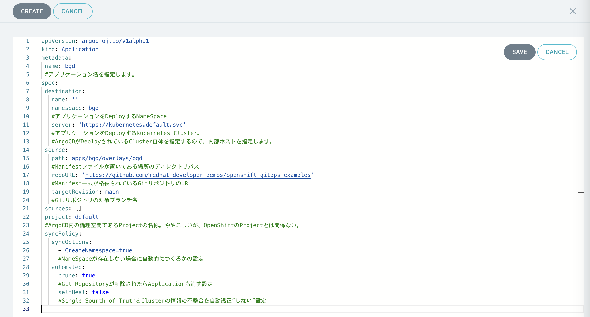

- 「**SAVE**」をクリックし、ArgoCDのGUIにYAMLファイルが反映された結果を確認してみる

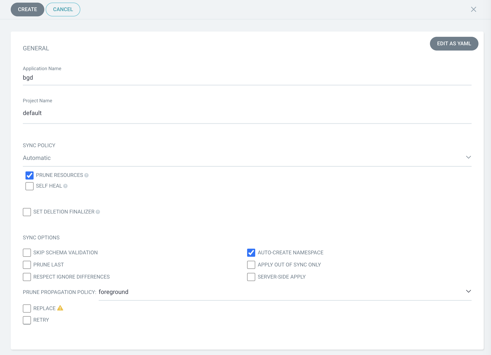

- 「**CREATE**」をクリックしてManifestを適用する
- Manifestが反映されたことを確認する

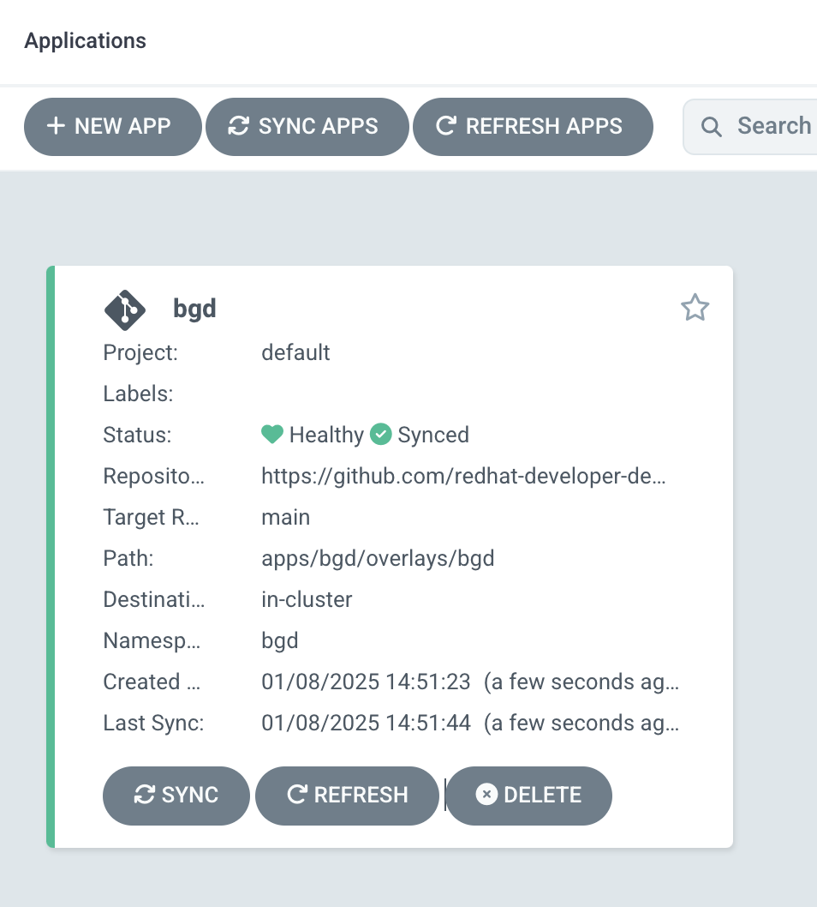

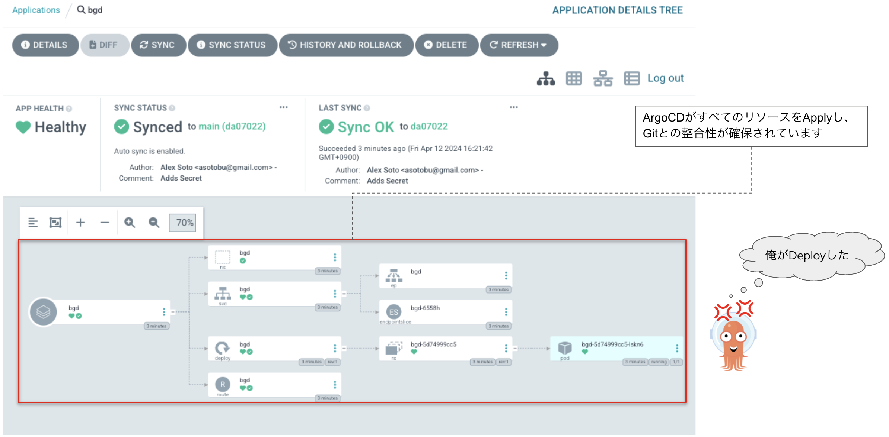

---
**■補足：** ArgoCD側にも独自の論理空間を有しており、その名称を「**Project**」と言います。これがOpenShiftの論理空間（NameSpace）である「プロジェクト」と同名で非常にややこしいです。このため、ArgoCD側のProjectを「ArgoCDプロジェクト」と表現したりします。ArgoCDプロジェクトは最初から`default`というプロジェクトが存在します。今回はこれを使います。
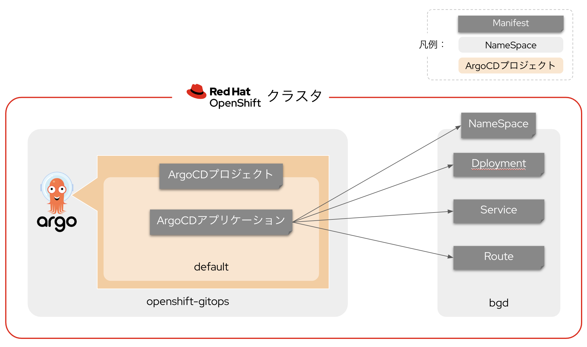

---

## サンプルアプリを操作する
RouteのURLからサンプルアプリケーションにアクセスしてみましょう。また、Deploymentで設定されている環境変数を触ってみて、泡の色を変えましょう。

### bgdアプリにアクセス

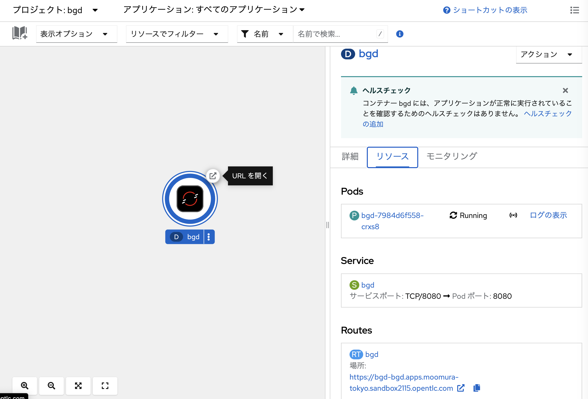

- コンソール画面を「**開発者向け表示**」に切り替え、左メニューの「**トポロジー**」を選択
- プロジェクト「**bgd**」内の「**bgd**」アプリのRoute URLをクリック
- アプリにアクセスする


### 環境変数を変更
- 「**(D)bgdをクリック**」
- 「**環境**」タブのCOLORの値を好きなものに変える
    - 以下の色は確認済みだが、まだ未発見のものがあるかも！
    - `blue`, `green`, `white`, `red`
- 「**保存**」をクリックして反映させる


---
**■補足：** Deployment（YAMLファイル）に存在する環境変数フィールドの内容はOpenShiftのGUIに自動的に反映されます。一応YAMLファイルの中身も確認してみてください。

```
apiVersion: apps/v1
kind: Deployment
...
spec:
  ...
  template:
    ...
    spec:
        ...
        env: ←ここ
        - name: COLOR
          value: "blue"
        ...
```

---

## ArogCDからGitリポジトリの内容に矯正
OpenShiftクラスタに適用されているDeploymentと、Gitリポジトリに保存されているDeploymentには差分（環境変数に異なる値が設定）が発生しています。これをArgoCD側からGitリポジトリ側の内容（**Single Source of Truth**）に矯正させます。

### ArgoCDのステータスを確認し、再度Syncを実施
- ArgoCDのコンソール画面にアクセス
- 「**SYNC STATUS**」がOutOfSyncになっている事を確認

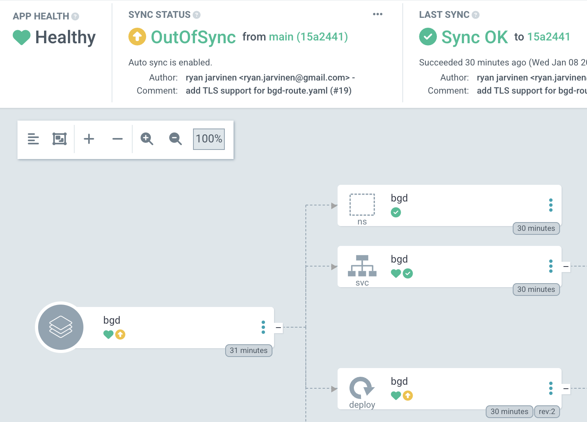

- 画面上部「**SYNC**」 → 「**SYNCHRONIZE**」をクリック
「**SYNC STATUS**」がSyncedとなったことを確認

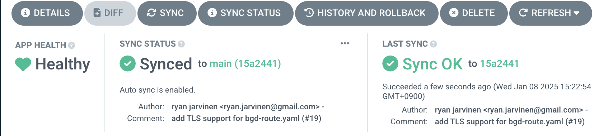

### 矯正結果を確認
- サンプルアプリ画面を更新し、泡の色が青（`blue`）に戻っていることを確認
- 「**(D)bgd-app**」の環境タブも再度確認し、`COLOR:blue`に戻っていることを確認

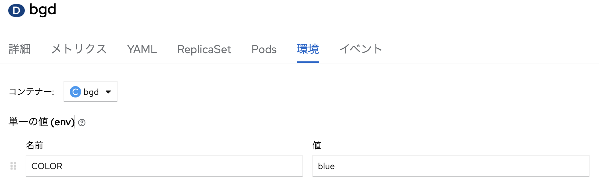

---
**■ 補足：** ArgoCDアプリケーションの設定によって、「**不整合を検知した瞬間にGitリポジトリの内容に矯正する**」を実現できます。その場合、ArgoCDアプリケーションの`spec.syncPolicy.automated.selfHeal`を`true`に変更します。
```
apiVersion: argoproj.io/v1alpha1
kind: Application
...
spec:
 ...
 syncPolicy:
   ...
   automated:
    ...
     selfHeal: false
     #Single Sourth of TruthとClusterの情報の不整合を自動矯正”する”設定
```

## まとめ
ArgoCDを利用した「**GitOps**」を体験しました。ManifestをGitリポジトリで管理し、ガバナンスとセキュリティを確保しながらアプリケーションを管理する手法について理解を深めることができました。


## 目次へ戻る
[こちら](https://gitlab.com/masaki-oomura/openshift-handson/-/blob/main/README.md?ref_type=heads)