# OpenShiftの基礎知識
Red Hat OpenShift（以下、OpenShiftと省略）は、「**エンタープライズのユーザが利用する上で最適なコンテナアプリケーションプラットフォーム**」です。


本章では、OpenShiftの特徴について、いくつかの観点で基礎知識をおさらいします。この後のハンズオンを進める上でも、いま一度基本的な技術知識について押さえておきましょう。

## コンテナ仮想化
コンテナ、あるいはコンテナ化とは、ITインフラの仮想化技術のひとつです。アプリケーションを動かす為の情報を最小限絞ったパッケージを作るというのがコンテナ化の特徴です。


### アプリケーションのソースコードまたは実行可能なバイナリ
アプリケーションの実行に必要なコードやバイナリが含まれます。

### ミドルウェア
必要に応じて、Webサーバ（例：Apache、NGINX）、データベースサーバ（例：PostgreSQL、MySQL）などのミドルウェアが含まれる場合があります。

### ライブラリや依存関係
アプリケーションやミドルウェアの動作に必要なライブラリが含まれます。例として、PythonならPyTorchやNumPy、Node.jsならExpressやLodashなどがあります。

### ベースイメージ
コンテナの基本的なOS環境を提供するイメージです。通常、Linuxディストリビューション（例：RHEL、 Ubuntu、Alpine、Debian）に含まれる最小限のライブラリやツールが含まれています。

コンテナの中にはOSのカーネルモジュールは含まれていません。このままだとアプリケーションは動きません。

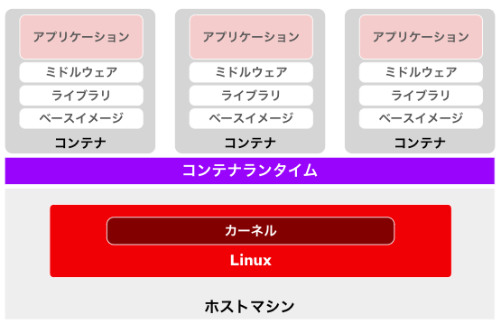

実は、コンテナはホストマシンにインストールされたLinux（ホストOS）のカーネルを共有することで動作します。各コンテナ内のアプリケーションやプロセスがカーネル機能を利用しながらも独立して動作できるのは、Linuxの以下の仕組みが利用されているためです。

### cgroup（コントロールグループ）
コンピュートリソース（CPU、メモリ、ディスクI/Oなど）を各コンテナごとに制限および管理するための仕組みです。

### 名前空間（namespace）
ファイルシステム、プロセスID（PID）、ネットワーク、ユーザIDなどのリソースを各コンテナごとに隔離する仕組みです。これにより、コンテナ間やホスト環境とコンテナ間のリソースが分離されます。

これらの仕組みの組み合わせにより、ホストカーネルを共有しながらも、コンテナごとにリソースの管理とデータの隔離が実現され、セキュリティと安定性が保たれています。

## コンテナイメージ
コンテナはコンテナイメージから作られます。コンテナイメージは、異なる環境でも同一のコンテナを再現して稼働させるために作られる実行環境のパッケージです。このパッケージには、アプリケーション、依存ライブラリ、設定ファイル、環境変数、およびベースイメージに含まれるOSの最小限の要素が含まれています。

コンテナイメージは通常、Dockerfileと呼ばれるテキスト形式のスクリプトを基に作成します。Dockerfileには、以下のような内容が記述されます。

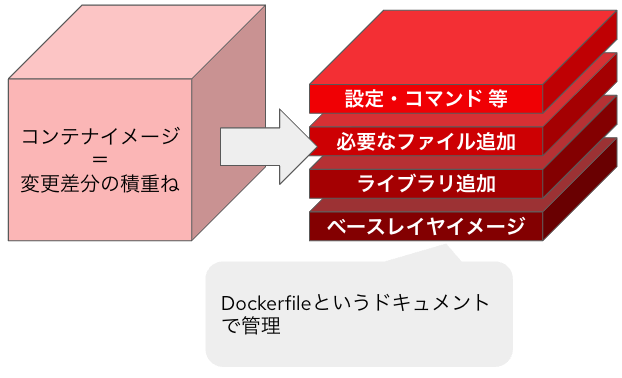

### ベースイメージの指定
例：FROM ubuntu:20.04

### 必要なライブラリやツールのインストール
例：RUN yum install

### アプリケーションのコピーやビルド
例：COPY や RUN）

### 実行するコマンドの指定
例：CMD 

このコンテンツで利用するNode.jsアプリケーションの[Dockerfile](https://gitlab.com/hikaru-nomura/openshift-handson/-/blob/main/pipeline-experience/sample-app/source/Dockerfile?ref_type=heads)を見てみましょう。

```
# ベースイメージの取得
# このベースイメージはRHEL8をベースに、さらにNode.js関連のモジュールをインストール済み
# Node.jsモジュールも含めてRed Hatが動作サポートしてくれる
FROM registry.access.redhat.com/ubi8/nodejs-18:latest

# コンテナ起動した後に遷移させる作業ディレクトリの設定
# コンテナ内の/usr/src/appに移動する
WORKDIR /usr/src/app

# このアプリで必要なNode.jsの追加ライブラリをインストール
# ユーザが独自に追加したライブラリについては当然ながらRed Hatの動作サポート範疇外である
RUN npm install express ejs

# node.jsアプリケーションの動作に必要なソースコードをコンテナ内の作業ディレクトリに転送
COPY . .

# コンテナを立ち上げた後に発動して欲しいコマンドを記載。
# コマンド毎に区切って記載しないといけない。
# node index.jsはNode.jsアプリの起動コマンド。
CMD ["node", "index.js"]
```

Dockerfileを使ってイメージをビルドすることで、一貫性のあるコンテナ環境を作成でき、開発環境、テスト環境、本番環境などで同じイメージを利用することが可能になります。

## コンテナランタイム
コンテナランタイムは、コンテナを実行・管理するためのソフトウェアです。具体的には、コンテナイメージを基にプロセスを作成し、必要なリソースや隔離環境を設定します。

代表的なコンテナランタイムには、DockerのランタイムやKubernetesで使われるcontainerd、CRI-Oなどがあります。これにより、アプリケーションが軽量かつ効率的に実行されます。

OpenShiftではCRI-Oが利用されます。

## コンテナを使いこなすために必要な要素
コンテナはあくまで「**インフラ仮想化の技術**」です。これをアプリケーションの開発運用の現場で本格的に**使いこなす**ためには、以下は事実上「**必須**」です。

### コンテナオーケストレータの活用
コンテナオーケストレータは、複数のコンテナを効率的に管理・調整するための仕組みです。これにより、コンテナのデプロイ、スケーリング、障害対応を自動化し、大規模なアプリケーション運用を実現します。Kubernetesが事実上のスタンダード（デファクト・スタンダード）です。Kubernetesを活用することで、運用の効率化と信頼性の向上が図れます。

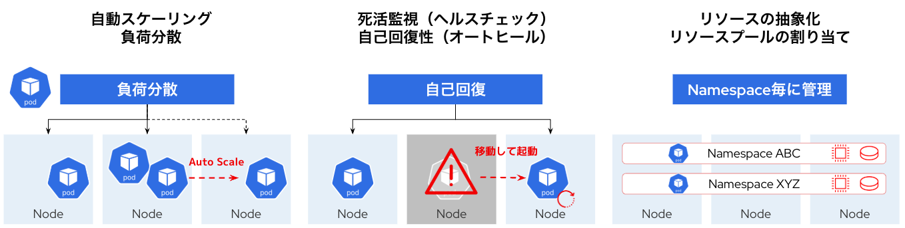

### CICDの実施
CICD（継続的インテグレーションと継続的デリバリー/デプロイ）は、ソフトウェアの開発からリリースまでのプロセスを自動化する手法です。コードの変更を頻繁に統合し、自動テストやビルドを行うことで、品質を高く保ちながらリリースの速度を向上させます。コンテナと組み合わせると、環境の一貫性を保ちながら、迅速に新機能を展開することが可能です。CICDを実施することで、開発と運用の連携が強化され、継続的な改善が促進されます。

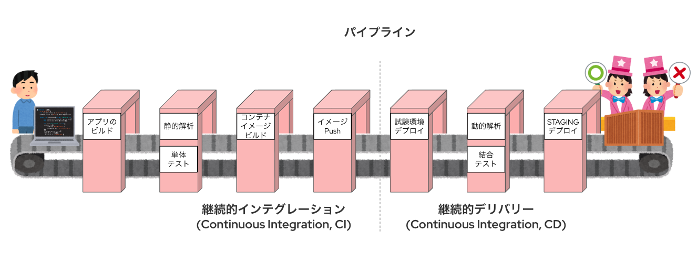

## Kubernetesとは
Kubernetesはコンテナ・オーケストレータのデファクトスタンダードであり、OpenShiftにも採用されているオープンソースのソフトウェアです。


### クラスタ
Kubernetesでは、複数の物理マシンや仮想マシンを束ね、クラスタを構成します。クラスタとして括られたひとつの大きなコンピュートリソースをNameSpaceと呼ばれる論理空間で分割します。

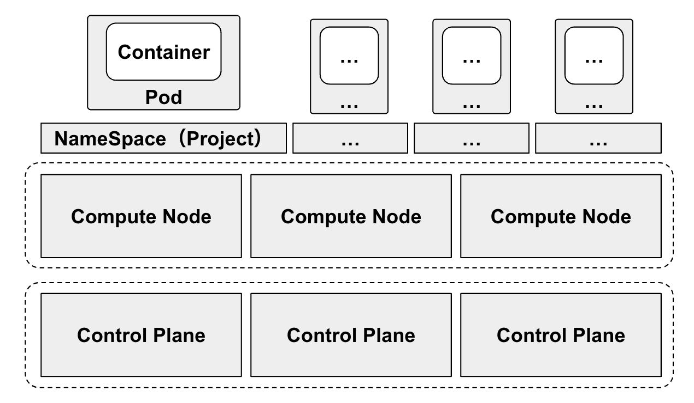

クラスタを構成する物理マシンや仮想マシンは「ノード（Node）」と呼ばれます。ノードには大きく3種類の役割が存在します。

**■ Control Plane** <br>
Kubernetesクラスタを管理することに特化した役割です。コンテナ・アプリケーションはControl Planeの上には配備されません。

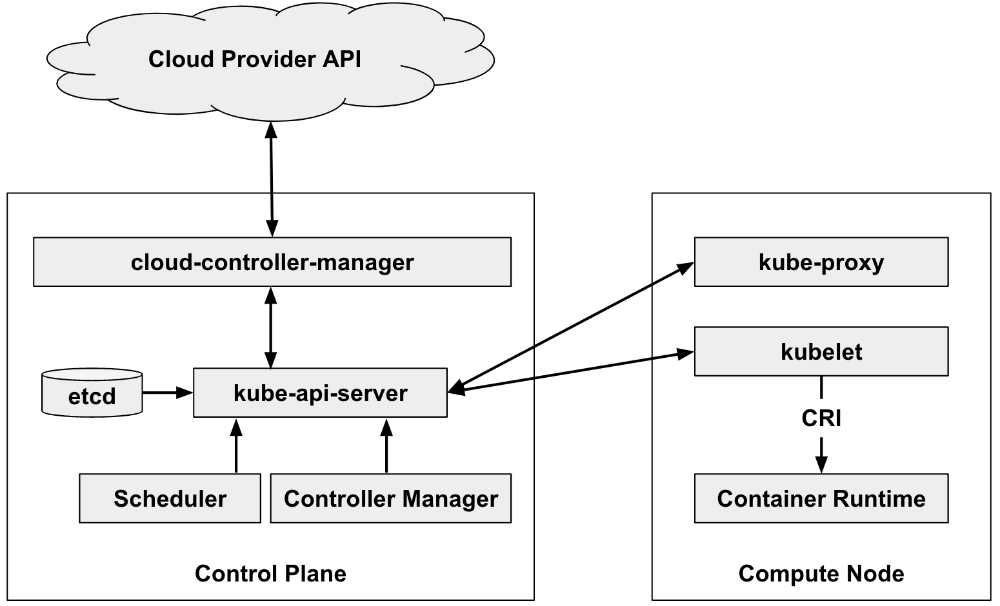
※各ノードのコンポーネントの細かい内容は[Kubernetes公式ドキュメント](https://kubernetes.io/docs/concepts/architecture/)を参照ください。このハンズオンにおいては細かく理解する必要はありません。

**■ Compute Node** <br>
クラスタのコンピュート・リソースを提供するノードです。Compute Nodeの上でコンテナ・アプリケーションが動きます。

**■ Infra Node** <br>
OpenShift独自のノード役割です。OpenShiftを構成する各種管理コンポーネント（それぞれがコンテナ・アプリケーションとして動作します）だけを動作させるためのノードです。ユーザが作成したアプリケーションを動作させることはできません。


### リソース管理
Kubernetes上のリソースはすべて「マニフェスト（Manifest）」と呼ばれるコードで管理します。マニフェストはYAMLと呼ばれる形式で記載します。各種リソースを表現したマニフェストをKubernetesクラスタに適用することで、コンテナアプリケーションを含めたあらゆるリソースをデプロイすることができます。

Kubernetes上のあらゆるリソース（※本当にあらゆる全てのリソース）は、YAML形式のコードで管理することができます。つまり、 **Infrastructure as Code（IaC）** を実現することができます。

**■ Kubernetesで利用できる基本的なリソース** <br>
基本的なリソースの組み合わせだけでも、一般的なシステム（例：WebアプリとDatabase）を構築することが可能です。

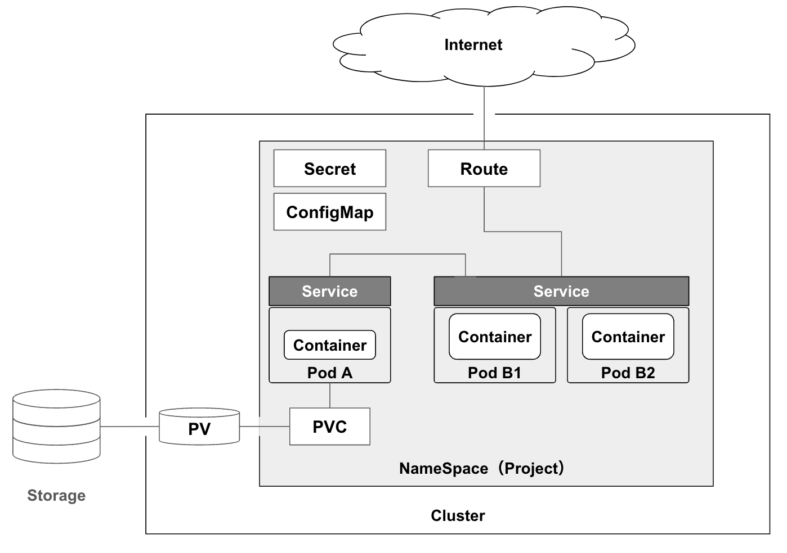

|基本的なリソース名|詳細|
|---|---|
|Pod|Kubernetesの基本的なデプロイメント単位で、1つまたは複数のコンテナが共有するネットワークやストレージの環境を提供する。<br>コンテナはPod内で一緒に動作し、同じIPアドレスを共有する。|
|ReplicaSet|指定した数のPodを常に稼働状態に保つKubernetesリソース。<br>例として、Podが停止した場合、自動的に新しいPodを作成して復旧を図る。|
|Deployment|アプリケーションの管理と更新を簡単にするために、ReplicaSetの作成や管理を行うリソース。<br>ローリングアップデートやリソースのロールバック機能を提供する。|
|Service|Kubernetes内のPodにネットワークアクセスを提供するためのリソース。<br>動的に変化するPodのIPアドレスを抽象化し、クラスタ内一定のアクセスポイントを提供する。|
|Route|アプリケーションを外部からアクセス可能にするためのOpenShift独自のリソース。<br>Serviceによってクラスタ内に開放されるアクセスポイントをインターネットに公開する。L7ロードバランサとして振る舞い、TLS（HTTPS）設定も可能。|
|ConfigMap|設定情報をKubernetes内で管理するためのリソースで、環境変数や設定ファイルなどをPodに渡すことができる。<br>アプリケーションの設定をコードから分離することで、柔軟な管理が可能になる。|
|Secret|パスワードやAPIキーなどの機密情報を安全に管理するためのKubernetesリソース。<br>データはBase64でエンコードされ、Podに環境変数やボリュームとして渡すことができる。|
|PersistentVolumeClaim（PVC）|ユーザーが必要なストレージ容量やアクセスモードを指定して、PersistentVolume (PV) を要求するためのリソース。<br>PVCがPVにバインドされることで、Podがストレージを利用できるようになる。|
|PersistentVolume （PV）|Kubernetesクラスタ内または外部ストレージプロバイダに存在する永続的なストレージを抽象化したリソース。<br>ストレージをPodに提供するためのインフラ側のリソースとして機能する。|

**■ YAMLファイルの例** <br>
以下に簡単なYAMLファイルの例を示します。
```
apiVersion: apps/v1
kind: Deployment
metadata:
  name: nginx-deployment
  labels:
    app: nginx
spec:
  replicas: 3
  selector:
    matchLabels:
      app: nginx
  template:
    metadata:
      labels:
        app: nginx
    spec:
      containers:
      - name: nginx
        image: nginx:1.14.2
        ports:
        - containerPort: 8080
```
このYAMLファイルの意味は以下の通りです。
- nginxを3つのPodとしてデプロイします
- Podのラベル（Key: Value）には`app: nginx`を付与します。
- nginxは8080番ポートを開放します
- nginxのコンテナイメージは公式提供されるVer1.14.2を使います

## OpenShiftとは
エンタープライズでの利用に最適なコンテナアプリケーション・プラットフォームです。オーケストレータにKubernetesを採用し、DevSecOpsを実現する為のあらゆるツールが揃っており、ハイブリッド・クラウドで利用できます。

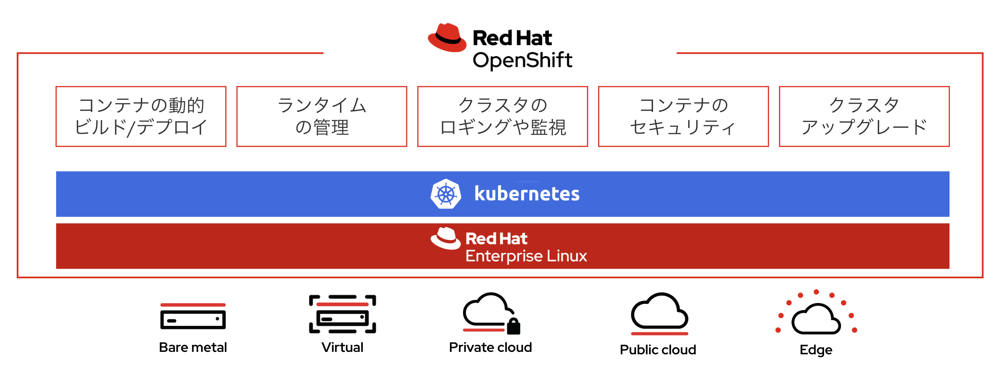

### OpenShiftの"推し"

**■ オンプレでもクラウドでも全く同じプラットフォームを再現** <br>
OpenShiftはオンプレミスのサーバにインストールして利用する「**Self-Manage**」な利用に加え、パブリック・クラウドの「**Managed-Service**」として従量課金で利用することもできます。

|パブリック・クラウドサービス|提供するOpenShift|
|---|---|
|AWS|[Red Hat OpenShift Service on AWS（ROSA）](https://aws.amazon.com/jp/rosa/)|
|Azure|[Azure Red Hat OpenShift（ARO）](https://azure.microsoft.com/ja-jp/products/openshift)|
|GCP|[OpenShift Dedicated（OSD）](https://www.redhat.com/en/technologies/cloud-computing/openshift/dedicated)|
|IBM Cloud|[Red Hat OpenShift on IBM Cloud（RHOIC）](https://www.ibm.com/jp-ja/products/openshift)|


**■ コンソール画面（GUI）でなんでもできる** <br>
Kubernetesを利用する上でまずハードルになるのがコマンド操作です。OpenShiftでは多くのリソースの可視化・操作がコンソール画面を介して可能になっています

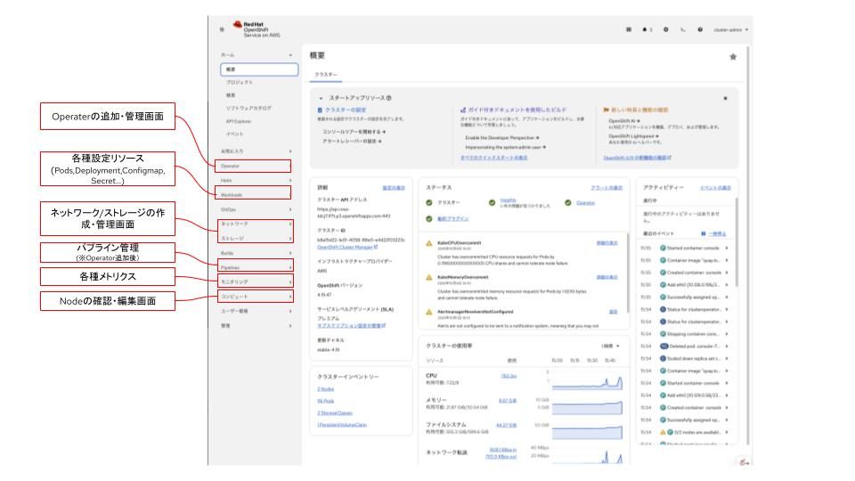

---
※コンソール画面の詳細は[OpenShiftコンソール画面ツアー](https://gitlab.com/hikaru-nomura/openshift-handson/-/blob/main/openshift-console-tour/text.md?ref_type=heads)で触れます。


**■ Operatorを利用したアドオン管理機能** <br>
OpenShiftでは、Kubernetesの上で動かすミドルウェアのインストール・運用自動化をKubernetes Operator(Operator)という機能で実装しています。

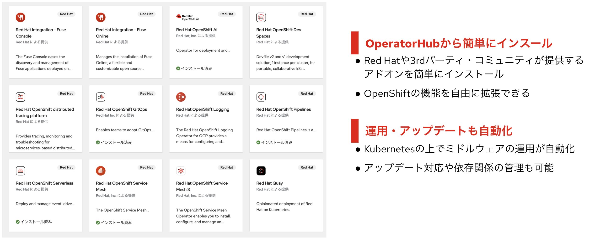

OpenShift Container Platformには、コンテナの開発運用を高度化するための複数のOperatorが標準で含まれています。

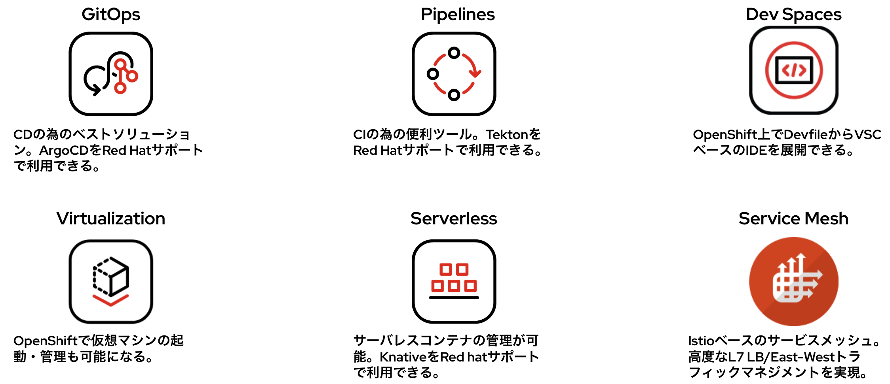

**■ 仮想マシンも動く** <br>
OpenShift Virtualizataionによって仮想マシン（RHEL/Win）が動きます。Migration Toolkit for Vritualization（MTV）によって、既存の仮想基盤からのマイグレーション（移行）も簡単に行えます。

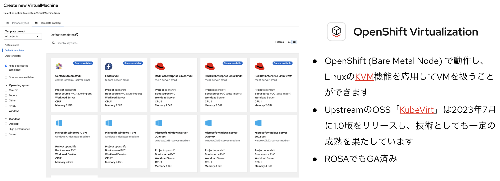

OpenShift4.17以降では、OpenShift Virtualizationを利用可能にすると、専用GUIが利用できるようになります。

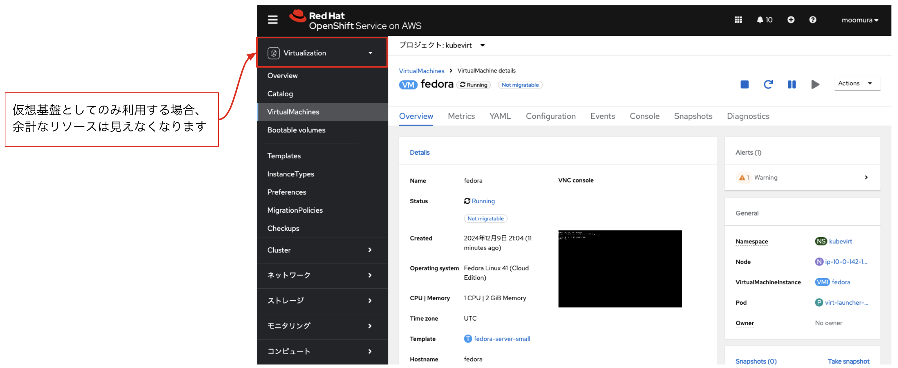

---

OpenShift Virtualizataionは次世代の仮想基盤としても非常に注目されています。
- [どうする「脱VMware」、ユーザー企業が検討する主な移行先は3種類（日経クロステック）](https://xtech.nikkei.com/atcl/nxt/column/18/02864/062400006/)
- [レガシー仮想基盤の刷新アプローチ　「脱VMware」は課題一掃のチャンス（週間BCN+）](https://www.weeklybcn.com/journal/feature/detail/20241021_206617.html)

---


**■ JupyterLabも生成AIも動く** <br>
OpenShift AIによって、大規模言語モデル（LLM）やニューラル・ネットワークのモデルをコンテナとしてホストできます。データサイエンティスト向けの統一的なPython開発環境（JupiterLab）もコンテナで払い出せます。

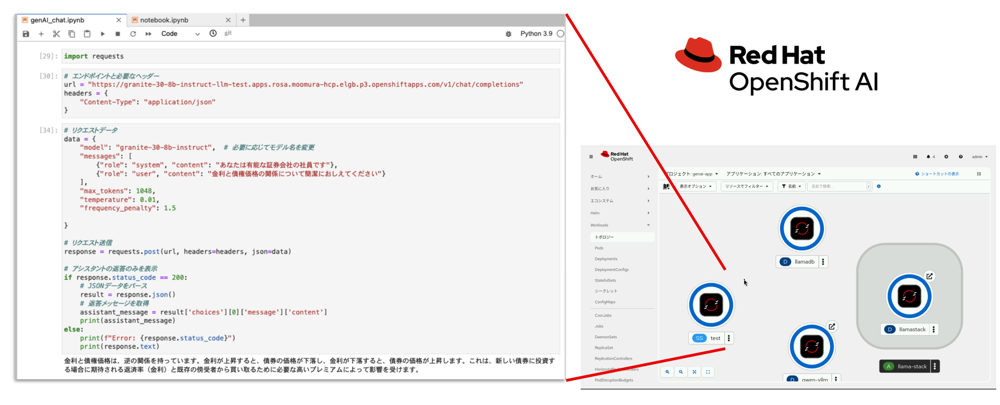

**■ ハイブリッドクラウド・ハイブリッドワークロード** <br>
Red Hat OpenShiftを活用すれば、あらゆるインフラの上であらゆる種類のワークロードを展開し、クラウドネイティブな開発環境や自動化の推進が実現できます。

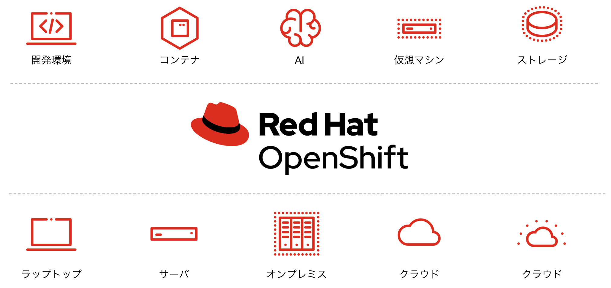

## 目次へ戻る
[こちら](../README.md)
