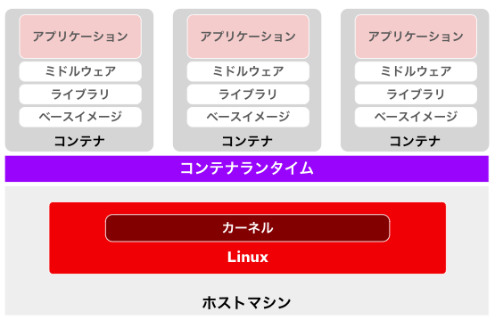
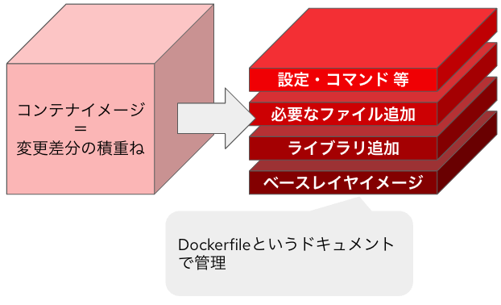
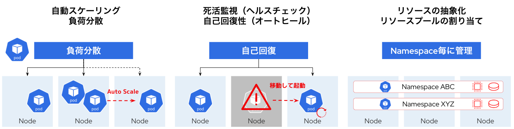
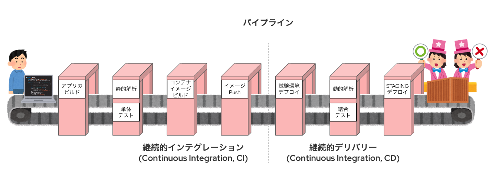

# OpenShiftの基礎知識
Red Hat OpenShift（以下、OpenShiftと省略）は、「**エンタープライズのユーザが利用する上で最適なコンテナアプリケーションプラットフォーム**」です。


本章では、OpenShiftの特徴について、いくつかの観点で基礎知識をおさらいします。この後のハンズオンを進める上でも、いま一度基本的な技術知識について押さえておきましょう。

## コンテナ仮想化
コンテナ、あるいはコンテナ化とは、ITインフラの仮想化技術のひとつです。アプリケーションを動かす為の情報を最小限絞ったパッケージを作るというのがコンテナ化の特徴です。


### アプリケーションのソースコードまたは実行可能なバイナリ
アプリケーションの実行に必要なコードやバイナリが含まれます。

### ミドルウェア
必要に応じて、Webサーバ（例：Apache、NGINX）、データベースサーバ（例：PostgreSQL、MySQL）などのミドルウェアが含まれる場合があります。

### ライブラリや依存関係
アプリケーションやミドルウェアの動作に必要なライブラリが含まれます。例として、PythonならPyTorchやNumPy、Node.jsならExpressやLodashなどがあります。

### ベースイメージ
コンテナの基本的なOS環境を提供するイメージです。通常、Linuxディストリビューション（例：RHEL、 Ubuntu、Alpine、Debian）に含まれる最小限のライブラリやツールが含まれています。

コンテナの中にはOSのカーネルモジュールは含まれていません。このままだとアプリケーションは動きません。



実は、コンテナはホストマシンにインストールされたLinux（ホストOS）のカーネルを共有することで動作します。各コンテナ内のアプリケーションやプロセスがカーネル機能を利用しながらも独立して動作できるのは、Linuxの以下の仕組みが利用されているためです。

### cgroup（コントロールグループ）
コンピュートリソース（CPU、メモリ、ディスクI/Oなど）を各コンテナごとに制限および管理するための仕組みです。

### 名前空間（namespace）
ファイルシステム、プロセスID（PID）、ネットワーク、ユーザIDなどのリソースを各コンテナごとに隔離する仕組みです。これにより、コンテナ間やホスト環境とコンテナ間のリソースが分離されます。

これらの仕組みの組み合わせにより、ホストカーネルを共有しながらも、コンテナごとにリソースの管理とデータの隔離が実現され、セキュリティと安定性が保たれています。

## コンテナイメージ
コンテナはコンテナイメージから作られます。コンテナイメージは、異なる環境でも同一のコンテナを再現して稼働させるために作られる実行環境のパッケージです。このパッケージには、アプリケーション、依存ライブラリ、設定ファイル、環境変数、およびベースイメージに含まれるOSの最小限の要素が含まれています。

コンテナイメージは通常、Dockerfileと呼ばれるテキスト形式のスクリプトを基に作成します。Dockerfileには、以下のような内容が記述されます。



### ベースイメージの指定
例：FROM ubuntu:20.04

### 必要なライブラリやツールのインストール
例：RUN yum install

### アプリケーションのコピーやビルド
例：COPY や RUN）

### 実行するコマンドの指定
例：CMD 

このコンテンツで利用するNode.jsアプリケーションの[Dockerfile](https://gitlab.com/masaki-oomura/openshift-handson/-/blob/main/pipeline-experience/sample-app/source/Dockerfile?ref_type=heads)を見てみましょう。

```
# ベースイメージの取得
# このベースイメージはRHEL8をベースに、さらにNode.js関連のモジュールをインストール済み
# Node.jsモジュールも含めてRed Hatが動作サポートしてくれる
FROM registry.access.redhat.com/ubi8/nodejs-18:latest

# コンテナ起動した後に遷移させる作業ディレクトリの設定
# コンテナ内の/usr/src/appに移動する
WORKDIR /usr/src/app

# このアプリで必要なNode.jsの追加ライブラリをインストール
# ユーザが独自に追加したライブラリについては当然ながらRed Hatの動作サポート範疇外である
RUN npm install express ejs

# node.jsアプリケーションの動作に必要なソースコードをコンテナ内の作業ディレクトリに転送
COPY . .

# コンテナを立ち上げた後に発動して欲しいコマンドを記載。
# コマンド毎に区切って記載しないといけない。
# node index.jsはNode.jsアプリの起動コマンド。
CMD ["node", "index.js"]
```

Dockerfileを使ってイメージをビルドすることで、一貫性のあるコンテナ環境を作成でき、開発環境、テスト環境、本番環境などで同じイメージを利用することが可能になります。

## コンテナランタイム
コンテナランタイムは、コンテナを実行・管理するためのソフトウェアです。具体的には、コンテナイメージを基にプロセスを作成し、必要なリソースや隔離環境を設定します。

代表的なコンテナランタイムには、DockerのランタイムやKubernetesで使われるcontainerd、CRI-Oなどがあります。これにより、アプリケーションが軽量かつ効率的に実行されます。

OpenShiftではCRI-Oが利用されます。

## コンテナを使いこなすために必要な要素
コンテナはあくまで「**インフラ仮想化の技術**」です。これをアプリケーションの開発運用の現場で本格的に**使いこなす**ためには、以下は事実上「**必須**」です。

### コンテナオーケストレータの活用
コンテナオーケストレータは、複数のコンテナを効率的に管理・調整するための仕組みです。これにより、コンテナのデプロイ、スケーリング、障害対応を自動化し、大規模なアプリケーション運用を実現します。代表的なツールには、KubernetesやOpenShiftがあり、複雑なアプリケーションをクラスタ全体で安定して稼働させます。コンテナオーケストレータを活用することで、運用の効率化と信頼性の向上が図れます。



### CICDの実施
CICD（継続的インテグレーションと継続的デリバリー/デプロイ）は、ソフトウェアの開発からリリースまでのプロセスを自動化する手法です。コードの変更を頻繁に統合し、自動テストやビルドを行うことで、品質を高く保ちながらリリースの速度を向上させます。コンテナと組み合わせると、環境の一貫性を保ちながら、迅速に新機能を展開することが可能です。CICDを実施することで、開発と運用の連携が強化され、継続的な改善が促進されます。



## Kubernetesとは
Kubernetesはコンテナオーケストレータのデファクトスタンダードであり、OpenShiftにも採用されているオープンソースのソフトウェアです。

### クラスタ
Kubernetesでは、複数の物理マシンや仮想マシンを束ね、クラスタを構成します。クラスタとして括られたひとつの大きなコンピュートリソースをNameSpaceと呼ばれる論理空間で分割します。

### リソース管理
Kubernetes上のリソースはすべて「マニフェスト（Manifest）」と呼ばれるコードで管理します。マニフェストはYAMLと呼ばれる形式で記載します。各種リソースを表現したマニフェストをKubernetesクラスタに適用することで、コンテナアプリケーションを含めたあらゆるリソースをデプロイすることができます。