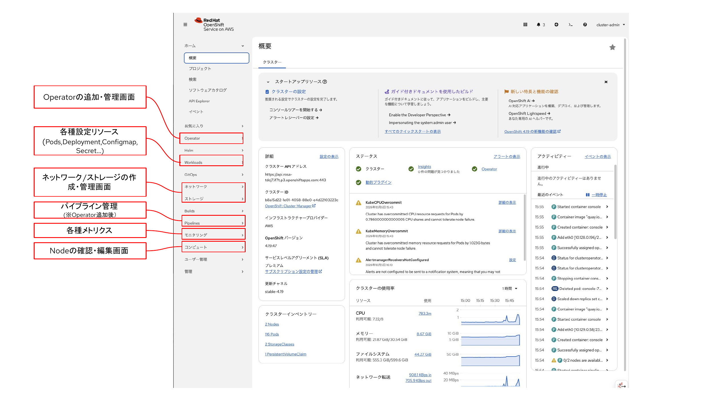

# OpenShiftコンソール画面ツアー
　OpenShiftの画面コンソールでは、クラスタ全体の管理からアプリケーションのデプロイ・運用までをひとつの画面で参照・操作できます。

## コンソール画面の機能
クラスタを構成する要素（ノード・ストレージ・ネットワーク 等）の管理や、各Namespace内でのアプリケーション運用を行います。

## 目次へ戻る
[こちら](../README.md)