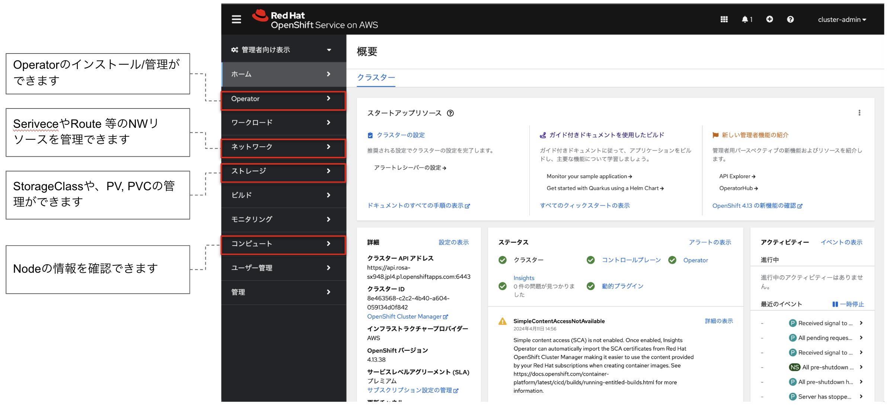
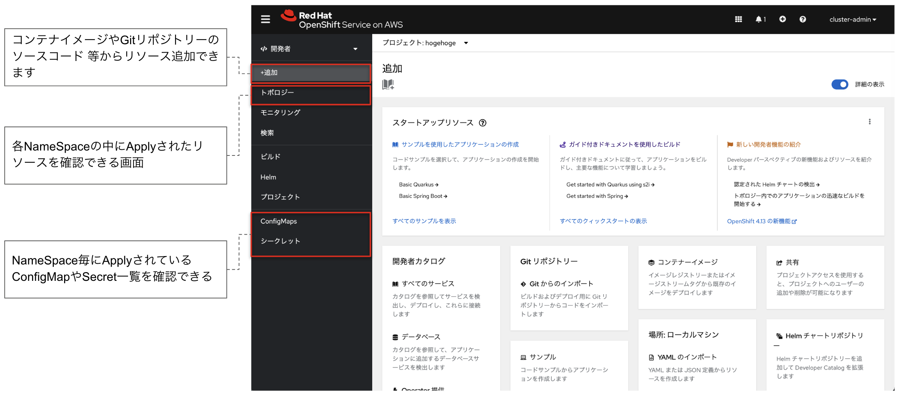

# OpenShiftコンソール画面ツアー
　OpenShiftの画面コンソールには大きく2つのビューが存在します。まずは「管理者」向けを見ていきましょう。

## 管理者向け表示
　OpenShiftのクラスタを管理するユーザ向けの表示です。クラスタを構成する要素（ノード・ストレージ・ネットワーク 等）を参照・操作する役割を有しています。管理者には様々な権限を付与することができ、最も強い権限を持つのが「cluster-admin」です。

## 開発者向け表示
　クラスタの中でアプリケーションをデプロイ・運用する、アプリケーション開発者向けの表示です。参照・操作権限を与えられたNameSpace内の各種リソースを操作できます。

## 目次へ戻る
[こちら](https://gitlab.com/masaki-oomura/openshift-handson/-/blob/main/README.md?ref_type=heads)