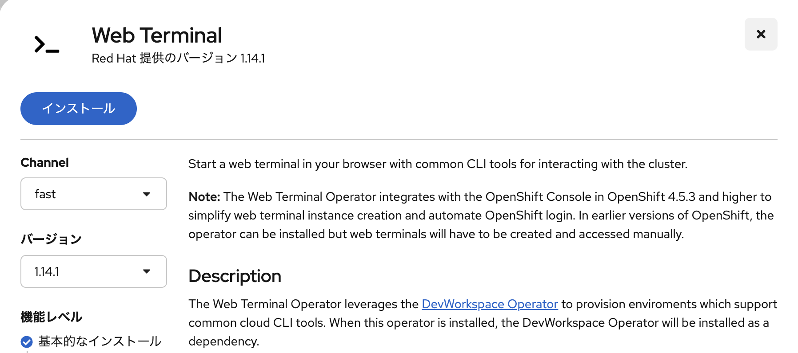
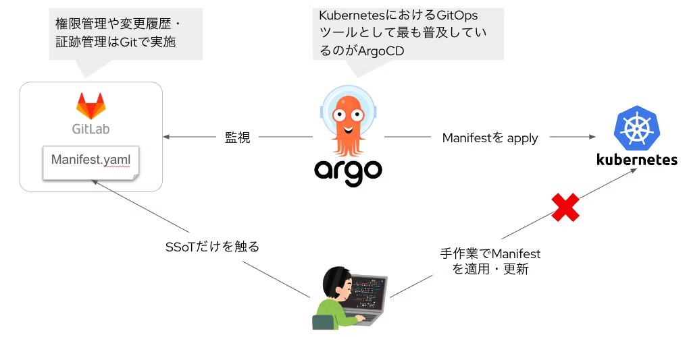
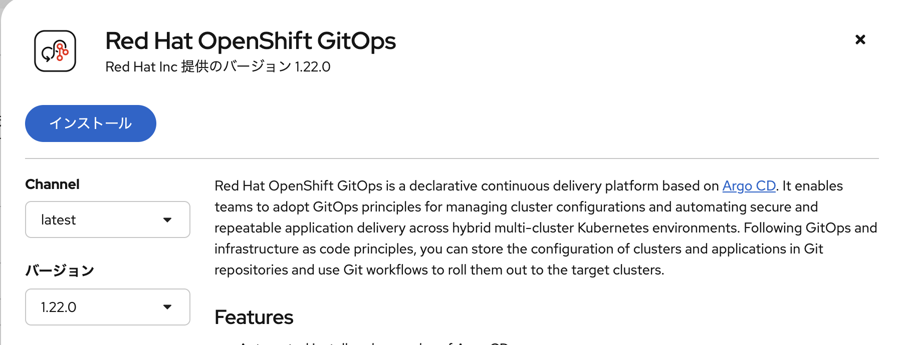
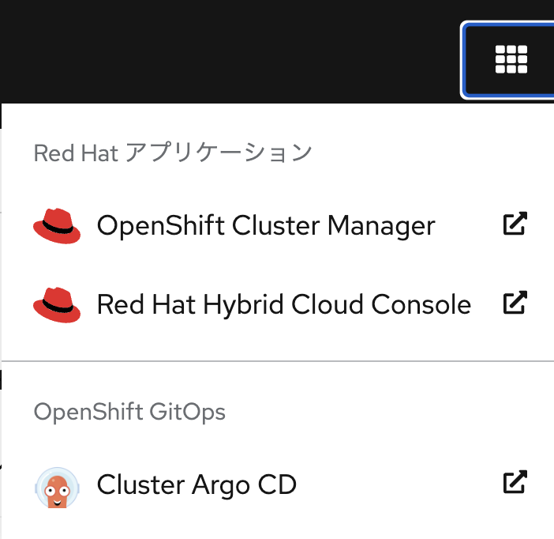
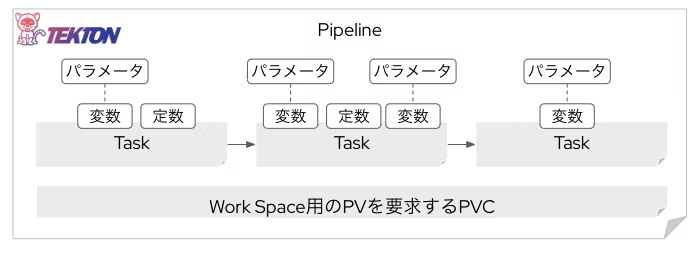

# Opetatorをインストール
「**Operator**」は、OpenShiftの機能を拡張する方法のひとつです。「**OperatorHub**」から、様々なOperatorをインストールできます。Red Hatが提供する公式Operatorから、ソフトウェアベンダの認定Operator、コミュニティが提供するものまで存在します。

このあと利用するいくつかのOperatorをインストールしておきます。

## Web Terminal Operator
「**Web Terminal Operator**」は、OpenShiftの画面コンソール上でコマンドライン（ターミナル）を利用できるようにする便利なOperatorです。OpenShiftはGUIでほとんどの操作を実現できますが、コマンドライン（CLI）を利用したい場面も存在します。そうした時に手軽にターミナルを利用できます。

### OperatorHubに移動
- 「管理者向け表示」に切り替え
- 左メニューの「Operator」から「Operator Hub」を選択

### Web Terminalをインストール
- `Web Terminal`を検索

```
Web Terminal
```

- デフォルト設定のままインストール
- 画面右上に出てくる「>_」をクリックして初期化し、Web Terminalを利用可能にする




- `oc version`と入力し、ocコマンドが利用できることを確認しておく

```
oc version
```


## OpenShift GitOps Operator
「**OpenShift GitOps Operator**」は、Red Hatが提供するOperatorです。OSS（オープン・ソース・ソフトウェア）の「**ArgoCD**」をRed Hatのサポート付きで利用できるOperatorです。

---
**■補足：** 「**GitOps**」とは、Gitに存在するManifestファイルを唯一無二の真実（Single Source of Truth）として管理し、ArgoCDというOSSがKubernetes Clusterに適用（Apply）する。手作業でManifestファイルをApplyさせず、変更反映もGitを介して行うプラクティスのこと。


### OperatorHubに移動して検索
- 先ほどと同様に「Operator Hub」を選択
- `OpenShift GitOps`を検索

```
OpenShift GitOps
```

- デフォルト設定のままインストール
- 「**Webコンソールの更新**」が表示されるのでクリックして画面を更新

### 事前準備（おまじない）
Web Terminalから以下のコマンドを実行しておいてください。
```
oc create -f - <<EOF
apiVersion: user.openshift.io/v1
kind: Group
metadata:
  name: cluster-admins
users:
  - cluster-admin
EOF
```

---

**■ ArgoCDとOpenShiftのRBACの関係** <br>
OpenShiftおよびArgoCDにはそれぞれ独自の「**ロールベースのアクセス制御（RBAC）**」を設定可能です。OpenShift GitOpsのデフォルト設定では、「OpenShift側のユーザが`cluster-admins`というグループに属するユーザにArgoCDのadmin権限を付与する」という設定になっています。そのため、自身のcluster-admin権限を持つユーザを当該グループに入れる設定を行います

---

- 画面右上の「アプリケーションタイル」からアクセスし、OpenShiftのSSOでログインしてみる





## OpenShift Pipelines Operator
「**OpenShift Pipelines Operator**」は、Red Hatが提供するOperatorです。OSS（オープン・ソース・ソフトウェア）の「**Tekton**」をRed Hatのサポート付きで利用できるOperatorです。

---
**■補足：** 「**Pipeline**」とは、CI/CD（継続的インテグレーションとデリバリー）の自動化を実現するためのワークフローを定義する仕組みです。TektonははKubernetesネイティブなPipeline管理ツールとして幅広く利用されています。



---

### OperatorHubに移動して検索
- 先ほどと同様に「Operator Hub」を選択
- `OpenShift Pipeline`を検索

```
OpenShift Pipeline
```

- デフォルト設定のままインストール


- 「**Webコンソールの更新**」が表示されるのでクリックして画面を更新
- コンソールの左メニューに「パイプライン」という項目が追加され、OpenShift Pipelinesが利用可能になる

## 目次へ戻る
[こちら](https://gitlab.com/masaki-oomura/openshift-handson/-/blob/main/README.md?ref_type=heads)