# Pipeline作成を体験
Kubernetesにおけるアプリケーションの開発運用をより効率的に実施するためにCI/CD（継続的インテグレーション/継続的デリバリー）の実施は「**必須**」と言っても過言ではありません。

CI/CDを実現するための各「**Task**」を管理し、アプリケーションを自動でデリバリーするまでの一連の流れを管理するリソースが「**Pipeline**」です。**OpenShift Pipelines**はOSSの「**Tekton**」を取り入れ、パイプラインをGUIで作成・管理する事ができるツールです。

## パイプラインを構成する要素
Tektonパイプラインを構成する主な要素は以下の3つです。
- Pipeline
- Task
- Workspace

それぞれ見ていきます。

### Pipeline
Pipelineとは、後述する「Task」の順序性や「Workspace」との紐づけを行い、「このTaskをやってOKだったら次はこのTaskを実行して...」を管理する存在です。また、各Taskに適用するパラメータ（変数）を定義します。

これらの要素を図解すると以下のようになります。
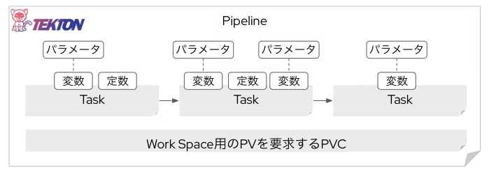

### Task
Taskは、文字通り何らかの作業です。例えば以下のようなTaskが存在します。
- Gitリポジトリに保存されているソースコードを`git clone`（ダウンロード）してくる
- ソースコードをスキャンする
- コンテナイメージをビルドする
- コンテナイメージをスキャンする
- コンテナイメージをPushする
- 任意のコマンドを実行する
- 等々

これらのTaskは実はコンテナイメージから起動するPodです。「**〇〇する**」Taskもひとつのコンテナアプリケーションとして動きます。そしてそれはKubernetes上ではPodとして起動・管理されます。Taskを実行するタイミングでPodが起動し、Taskが完了すればPodは削除されます。これの連なりがパイプラインです。

### Workspace
Podとして起動・実行される各Taskは、Task終了時にPodが消えてしまいますので、その間に生成されたデータも消えてしまいます。

例えば、「**① ソースコードを`git clone`（ダウンロード）してくるTask**」の後に、「**② ソースコードを静的解析するTask**」を実行したい場合を考えてみます。

Workspaceが無いと、**①**が完了すると、ダウンロードしてきたソースコードが消えてしまいます。そうすると次の**②**が実施できません。それは困ります。

そこで、パイプライン実行中に各Task間でやりとりされるデータを保持する場「**Workspace**」を提供する永続ボリュームが必要になります。つまり、パイプラインには基本的にひとつ以上の**PersistentVolume（PV）** が必要です。それを要求する **PersistentVolumeClaim（PVC）** も必要になります。

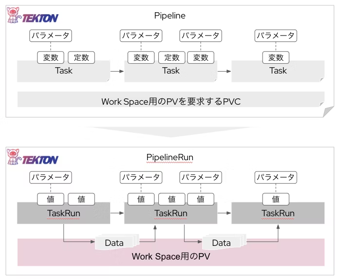

## やることの流れとイメージ
3つのTaskから構成されるパイプラインを作り、GitOpsと組み合わせてアプリケーションのCI/CDを実現しましょう。

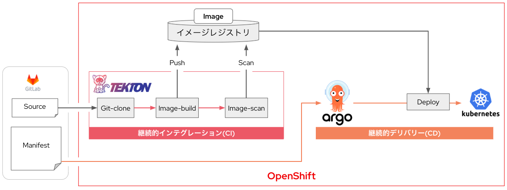

**■3つのTask**
- 任意のGitリポジトリからソースコードを`git clone`してくる
- ソースコードからイメージをビルドして内部レジストリに保存
- コンテナイメージをスキャンする

**■サンプルアプリについて**
- 入力内容をPodの「**ログ（標準出力）**」に出力するNode.jsアプリ
- 「**ホスト名：**」欄には起動中のPod名が表示される

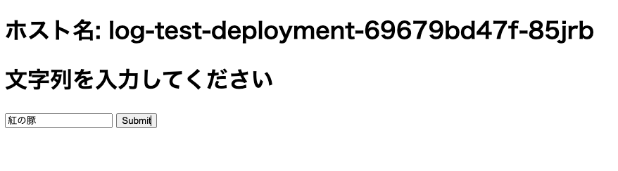
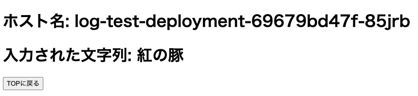
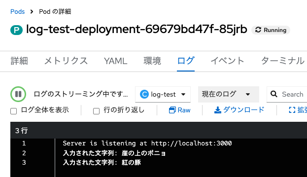

## ワークスペース用のPVCを作成しておく
パイプラインのワークスペースには、各Task実行中にデータを保存するためのPVCが必要です。そのPVCを事前に作成しておきます。

### PVC作成画面に移動
- OpenShiftのコンソール画面（管理者向け表示）にて、左メニュー「**ストレージ**」から「**PersistentVolumeClaims**」をクリックし
- 「**PersistentVolumeClaimの作成**」をクリックし「**with Form**」を選択
- 以下の通り値を設定し「**作成**」をクリック


|項目|設定内容|
|---|---|
|PersistentVolumeClaim 名|`workspace-pvc`|
|サイズ|`1` GiB|


---
**■補足：** YAMLファイルで作成する場合は以下のような内容になる。
```
kind: PersistentVolumeClaim
apiVersion: v1
metadata:
  name: workspace-pvc
  #PVCの名称
  namespace: myproject
  #適用先のNameSpace名
spec:
  accessModes:
    - ReadWriteOnce
  resources:
    requests:
      storage: 1Gi
  storageClassName: gp3-csi
  #永続ボリュームを払い出すストレージシステム
  #AWS環境のOpenShiftではAWS EBSが提供する「gp3-csi」というStorage Classが使える
  volumeMode: Filesystem
```
---
## パイプライン作成とTaskの追加

### パイプラインの新規作成
- 「**Pipelines**」メニューの「作成」プルダウンから「Pipeline」を選択
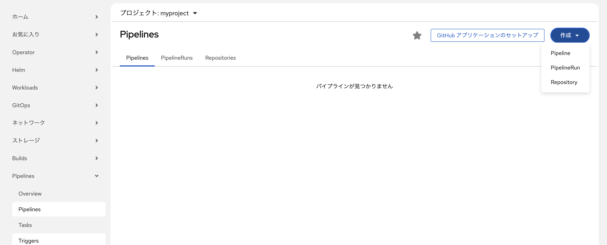

### Taskを3つ追加
- 「**Taskの追加**」をクリック

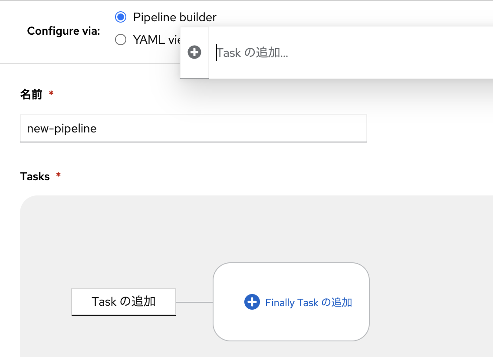

- 「**git-clone**」を追加

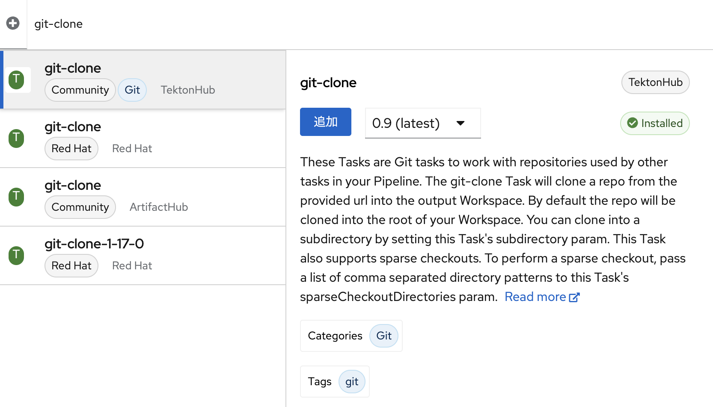

- 後に連続するTaskを追加

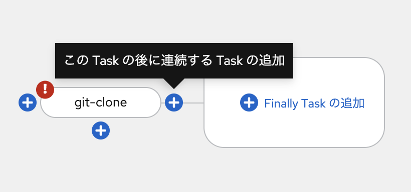

- 「**buildah**」を追加

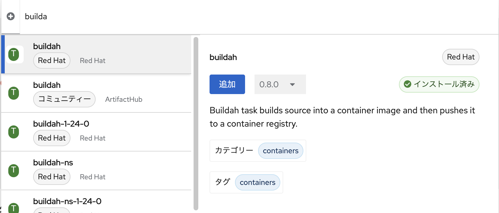

---
**■補足：** 「**Buildah**」はデーモンレスのビルドツールで、Red Hatが主導して開発しているOSSです。詳細は[こちら](https://www.redhat.com/ja/topics/containers/what-is-buildah)。
（ブルドッグがパンツ被っているようなアイコンです）


---

- 「**Finaly Task**」を追加する

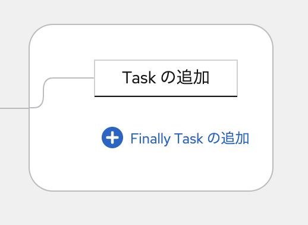

- 「**trivy-scanner**」を追加

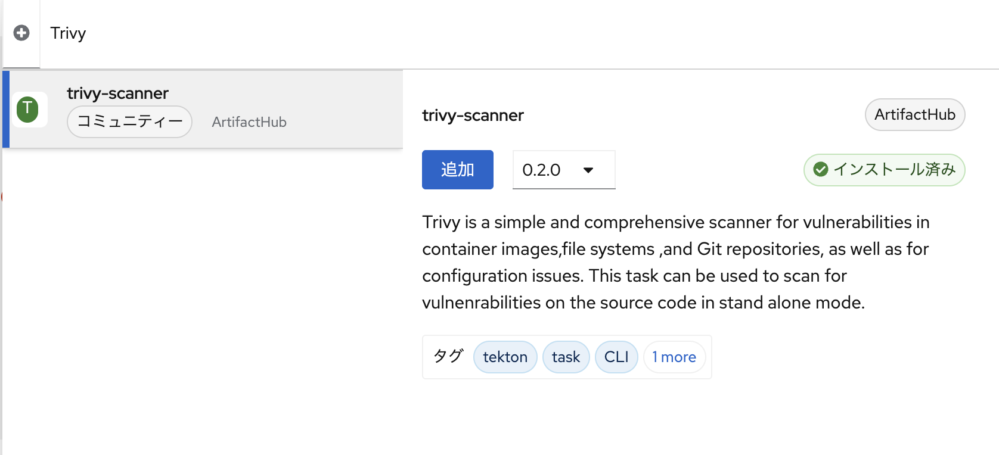

### Workspaceを追加
- 「**Add workspace**」をクリックし、名前欄に「`workspace`」と記載

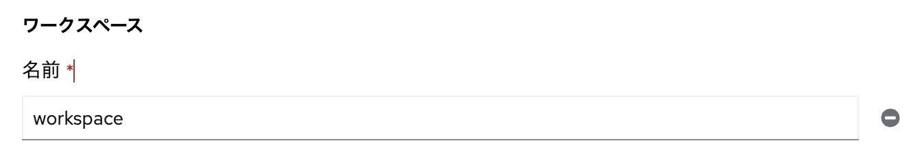
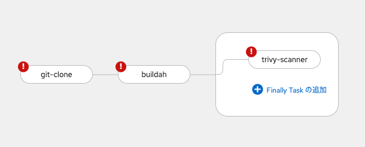

## パラメータの追加と設定
各Taskを実行するには、各Task毎に設定値を設定する必要があります。例えば、`git-clone`タスクには「**GitリポジトリのURL**」を値として与える必要があります。

ただし、Taskに各設定値をハードコーディングしてしまうと、「**特定のアプリにしか使えないパイプライン**」になってしまいます。このため、各TaskはPipeline側のパラメータを参照し、具体的な値はパイプライン実行時に与えるという設計を取るべきです。

具体的な作業を通して、上記の内容をしっかり確認していきましょう。

### パラメータを4つ追加
- 「**Add parameter**」を4回クリックして4つのパラメータを追加する

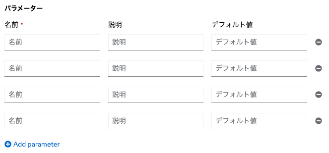

### 各パラメータに名前:デフォルト値を設定する
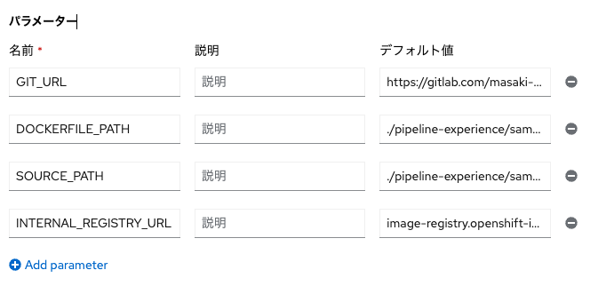

|名前	|説明	|デフォルト値|
|---|---|---|
|GIT_URL|ソースコードを取ってくる先のGitリポジトリのURL|`https://gitlab.com/masaki-oomura/openshift-handson.git`|
|DOCKERFILE_PATH|イメージをBuildする為のDockerfileのありかを示すパス|`./pipeline-experience/sample-app/source/Dockerfile`|
|SOURCE_PATH|イメージをBuildする対象のアプリケーションのソースコードのありかを示すパス|`./pipeline-experience/sample-app/source`|
|INTERNAL_REGISTRY_URL|コピー元の内部レジストリのURL|`image-registry.openshift-image-registry.svc:5000/myproject/log-test`|

---
**■補足：** 各パラメータの「**名前**」は任意のものを設定できます。ただし、万人が見てわかりやすいものを設定しましょう。

**例：GitリポジトリのURL**
- OK：GIT_URL, REPO_URL
- NG：A, CLONE, URL

また、必須ではありませんが、「**説明**」欄に各パラメータの意味を記載しておいてあげると、メンテナビリティの観点からも親切です。

「**デフォルト値**」は、パイプライン実行時の設定値のデフォルト値として利用する値を入れます。空欄にしておいても構いません。

---

## 各Task毎の設定値にパラメータを参照させる
ここから3つのTaskそれぞれに設定値を設定していきます。この際、設定値に直接値を入力せず、Pipeline側に設定されたパラメータを参照させます。

### git-cloneの設定
- 「**Tasks**」から当該Task名をクリック
- 必須パラメータを設定する

|パラメータ|詳細|設定するべき内容|
|---|---|---|
|url|Gitリポジトリのクローン先URL|`$(params.GIT_URL)`|

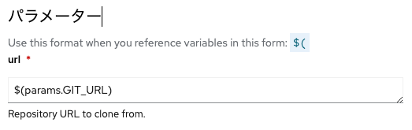

---
**■補足：** urlに直接GitリポジトリのURLを入力（ハードコーディング）してしまうと、このアプリ以外で当該パイプラインを使えなくなってしまう。これはNGパターン。
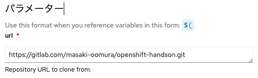

---

-  ワークスペース「output」に`workspace`を設定

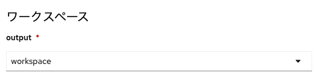

### buildahの設定
- 同様に必須パラメータを設定する

|パラメータ|詳細|設定するべき内容|
|---|---|---|
|IMAGE|OpenShiftの内部イメージレジストリのPATH|`$(params.INTERNAL_REGISTRY_URL)`|
|DOCKERFILE_PATH|Dockerfileが置いてあるディレクトリ|`$(params.DOCKERFILE_PATH)`|
|CONTEXT|ビルドするアプリのソースコードが置いてあるディレクトリ|`$(params.SOURCE_PATH)`|


---
**■補足①：** Tektonの各Taskは「[Tekton Hub](https://hub.tekton.dev/)」に詳細な使い方が記載されています。

---

---
**■補足②：** OpenShiftクラスタ内には最初からイメージレジストリ（内部レジストリ）が作られています。内部レジストリの命名規則は以下の通りです。

`image-registry.openshift-image-registry.svc:5000/<NameSpace名>/<アプリ名>`

---
- ワークスペース「source」に`workspace`を設定

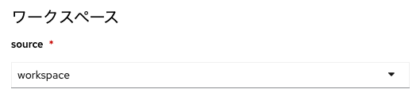

### trivy-scannerの設定
- 同様に必須パラメータを設定する
- 「**ARGS**」欄で「**値の追加**」を2回クリック
- 以下のように入力

|パラメータ|詳細|設定するべき内容|
|---|---|---|
|ARGS|trivyコマンドを入力する欄|`image`<br>`--severity HIGH,CRITICAL`|
|IMAGE_PATH|イメージスキャンする対象のコンテナイメージ格納先|`$(params.INTERNAL_REGISTRY_URL)`|


---
**■補足：** 「**Trivy**」は軽量な脆弱性検知ツールで、コンテナイメージもスキャンできます。コンテナイメージのみならず、ManifestファイルやIaCのファイル（Terraform 等）もスキャンできます。DesktopやServerにインストールして利用することもできますが、TektonのTaskとしても実行可能です。


なお、コンテナイメージをスキャンし、CVSSにて定義される深刻度(UNKNOWN、LOW、MEDIUM、HIGH、CRITICAL)からHIGH以上の脆弱性をチェック対象とする場合、以下のTrivyコマンドでスキャンすることが可能です。

```
trivy image IMAGE_NAME --severity HIGH,CRITICAL
```

つまり、「**ARGS**」欄にはTrivyコマンドを入力することになります。

---

### 保存をクリック
- 必要なパラメータが設定されたら「**保存**」をクリックします


## パイプラインを開始する
パイプラインが完成したので、さっそく動作させてみます。

### 「開始をクリック]
- パイプライン詳細画面の右上「**Actions**」から「**開始**」をクリック

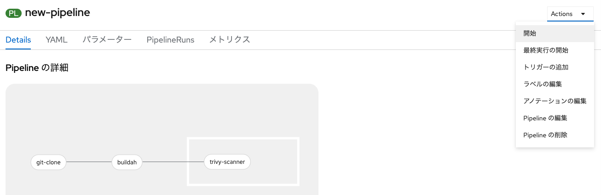

- パイプライン実行時の設定値に、パラメータのデフォルト値が入っていることを確認

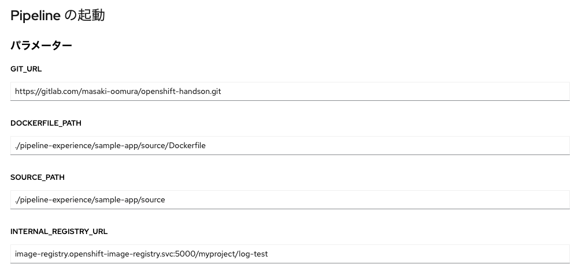

---
**■補足：** これらはあくまで「**デフォルト値**」なので、この画面で変更してパイプラインを実行することも可能です。

---

### ワークスペースのPVCを設定
- 事前に適用しておいたPVC「`workspace-pvc`」を設定

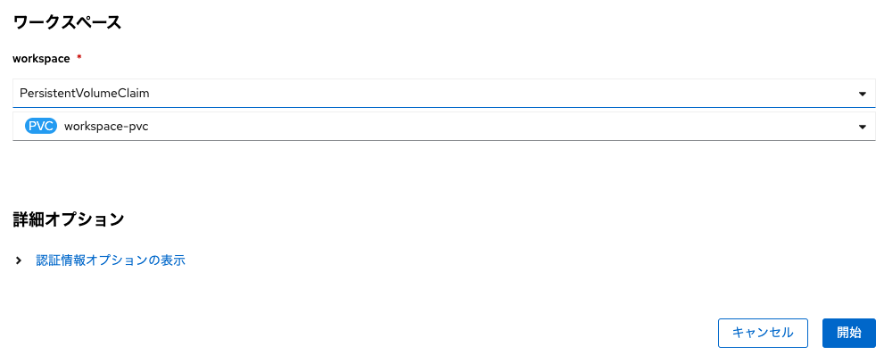

### パイプラインを開始
- 「**開始**」をクリックしてパイプラインを動作させる

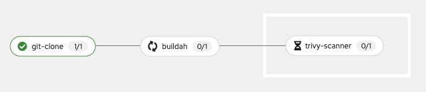

### パイプラインの実行結果を確認
- 「**ログ**」メニューで各Taskの実行結果を確認しておく

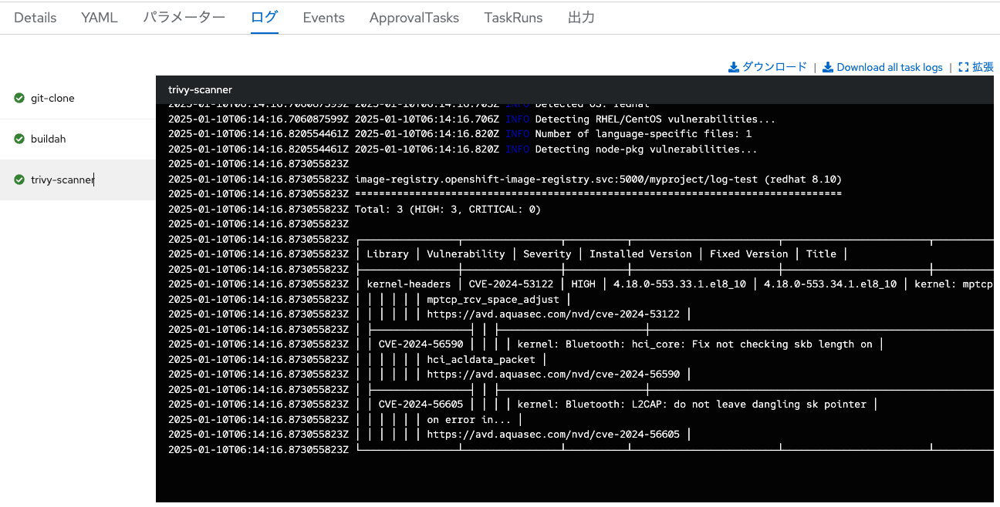

## ArgoCDアプリケーションを適用してアプリをデプロイ
ここまでの作業で作成・実行したパイプラインを使い、コンテナイメージのビルドとスキャンが完了しました。このイメージを使ってアプリケーションをデプロイします。デプロイはArgoCDアプリケーションを利用しましょう。

### log-testアプリのArgoCDアプリケーションを確認しておく
- [./pipeline-experience/sample-app/argocd-app/argocd-app.yaml](https://gitlab.com/masaki-oomura/openshift-handson/-/blob/main/pipeline-experience/sample-app/argocd-app/argocd-app.yaml)にアクセスする

```
apiVersion: argoproj.io/v1alpha1
kind: Application
metadata:
  name: log-test
  namespace: openshift-gitops
spec:
  destination:
    name: ''
    namespace: myproject
    server: https://kubernetes.default.svc
  source:
    path: ./pipeline-experience/sample-app/manifest
    repoURL: https://gitlab.com/masaki-oomura/openshift-handson.git
    targetRevision: main
  sources: []
  project: default
  syncPolicy:
    automated:
      prune: true
      selfHeal: true
    syncOptions:
      - CreateNamespace=true
```

### NameSpaceにArgoCDによる管理を許可するアノテーションを付ける
- Web Terminalを開き、以下コマンドを実行する

```
oc label namespace myproject argocd.argoproj.io/managed-by=openshift-gitops
```
---
**■補足：** ArgoCDによる管理（Manifestを適用、リソースを作成・編集・削除 等）を許可するためには、NameSpace（プロジェクト）に以下のようなラベルをつけておく必要があります。
```
kind: Project
metadata:
  name: myproject
  ...
  labels:
    argocd.argoproj.io/managed-by: openshift-gitops
```

---

### ArgoCDアプリケーションを適用する
- OpenShiftのWeb Terminalを開く
- 以下のコマンドを用いてArgoCDアプリケーションを適用する

```
oc apply -f https://gitlab.com/masaki-oomura/openshift-handson/-/raw/main/pipeline-experience/sample-app/argocd-app/argocd-app.yaml -n openshift-gitops
```

---
**■補足：** 「[gitops-experience](https://gitlab.com/masaki-oomura/openshift-handson/-/blob/main/gitops-experience/text.md?ref_type=heads#argocd%E3%81%8B%E3%82%89manifest%E3%82%92%E9%81%A9%E7%94%A8%E3%81%97%E3%81%A6%E3%82%82%E3%82%89%E3%81%86)」では、ArgoCDのコンソール画面からArgoCDアプリケーションのYAMLファイルを適用しましたが、ArgoCDのadmin権限を持つOpenShiftユーザがocコマンドを利用して直接YAMLファイルをクラスタに適用することもできます。

---

### ArgoCDのコンソール画面を確認する
- ArgoCDの「**Applications**」メニューで、「**log-test**」アプリのSync状態を確認する


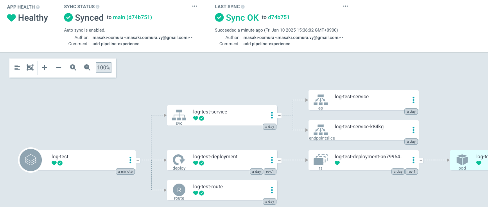

- OpenShiftのコンソール画面にて、「**トポロジー**」メニューから「**log-test**」アプリにアクセスする


- ログを出力して遊んでみる

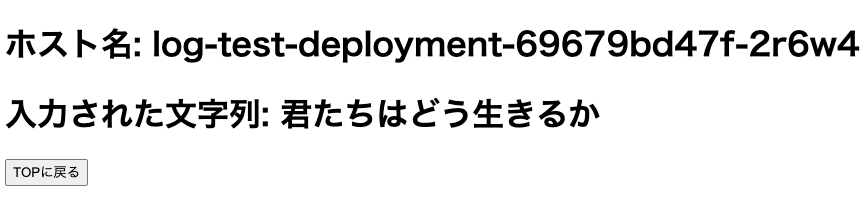

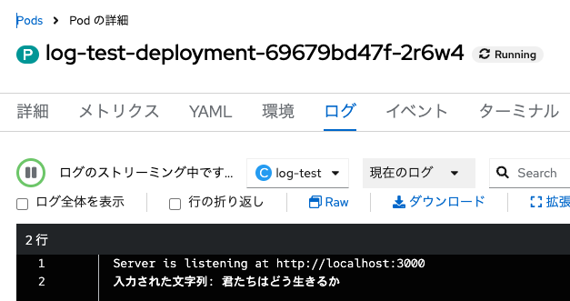

## まとめ
OpenShift Pipelinesを用いてパイプラインを作成しました。