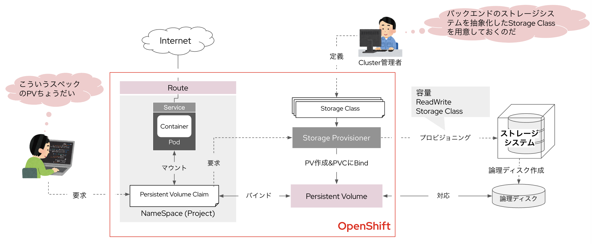
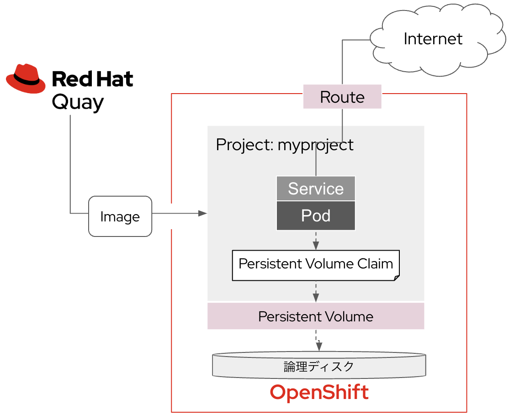
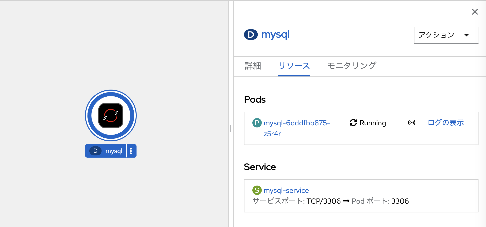
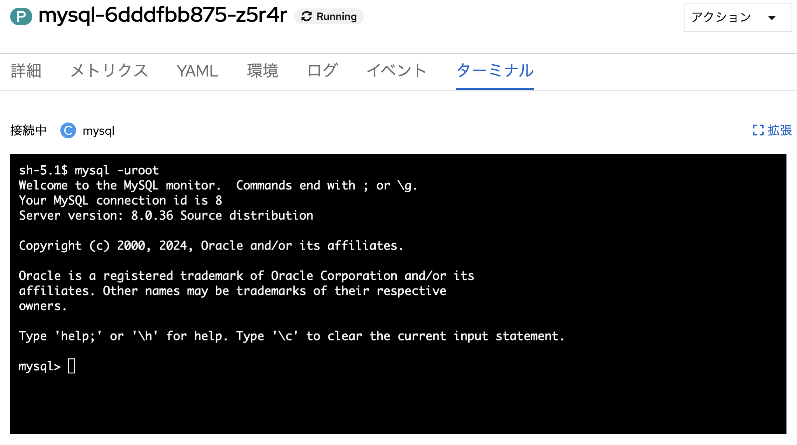
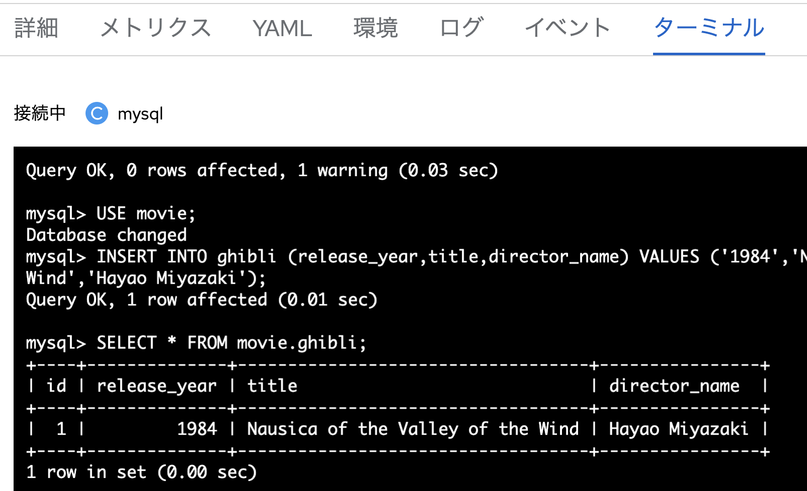
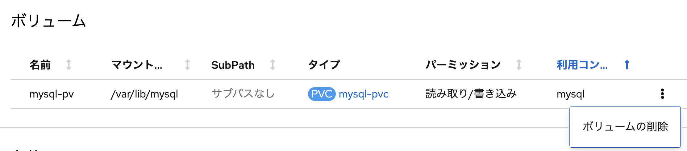
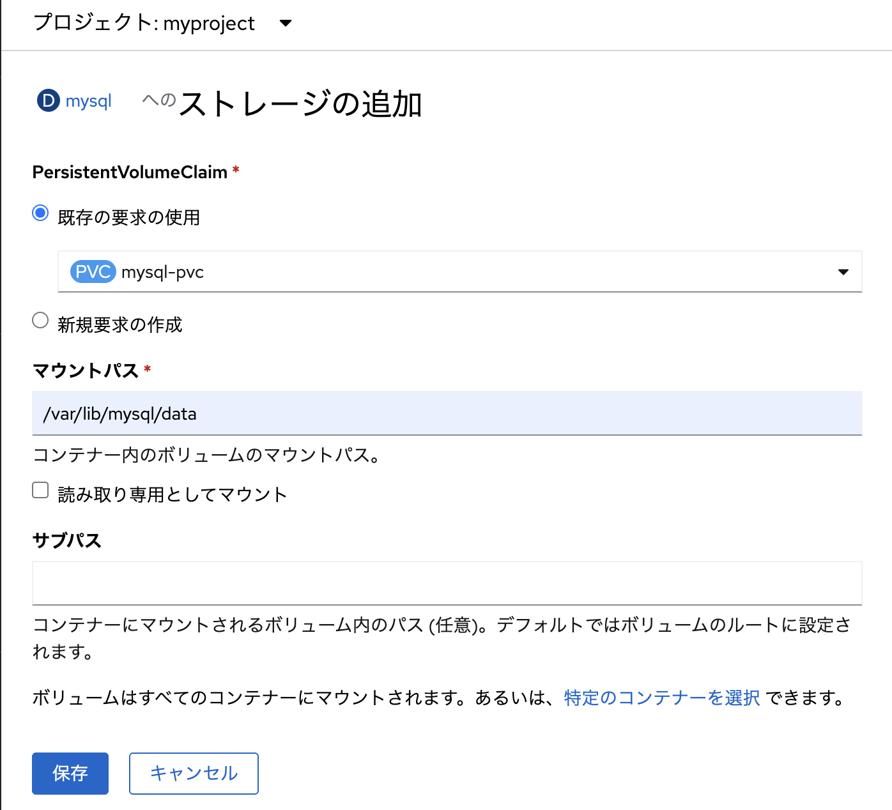
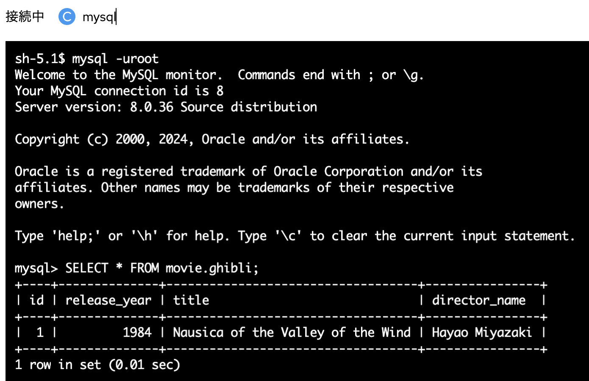

# 永続ボリュームを使う
Kubernetesにおいて永続ボリュームを利用する仕組みである「**PersistentVolume（PV）**」について学びます。Mysqlをコンテナとして起動し、データを永続化するためにPVを利用します。

PVCではStorage ClassとPVの要件を指定します。指定されたStorage Classに対応するストレージシステムから論理ディスクを払い出します。論理ディスクをKubernetesリソースとして表現したものがPVです。



**■やることのイメージと大まかな流れ**

- MysqlのManifest一式をApplyしMysqlをコンテナとしてデプロイ
- MysqlにログインしてDB&TBL作成
- PVをアンマウント＆再マウントしたりする
- Podを削除＆再作成されてもデータが保持されている事を確認する

## MysqlをDeployする
MysqlコンテナをアプリケーションとしてデプロイするためのManifestファイルを適用します。Manifestファイルは事前に用意されているものを使いますが、中身についても確認しておいてください。

今回利用するManifest一式は以下のリポジトリに格納されています。
- https://gitlab.com/masaki-oomura/mysql-k8s-demo.git
    - manifest: Manifest一式を格納したディレクトリ
    - sql: MysqlにDB&TBLを作成するためのSQLを格納したディレクトリ

### 各種のリソースを確認しApplyする
- 開発者表示でNameSpace「**myproject**」を選択
- 「**Web Terminal**」を起動し、以下のコマンドを適用してManifest一式を適用し、各種リソースを作成する

1. Manifestを適用するProjectを「myproject」に切り替える

    ```
    oc project myproject
    ```

2. Deploymentを適用する
    ```
    oc apply -f https://gitlab.com/masaki-oomura/mysql-k8s-demo/-/raw/main/manifest/mysql-deployment.yaml
    ```
---
3. PVCを適用する
    ```
    oc apply -f https://gitlab.com/masaki-oomura/mysql-k8s-demo/-/raw/main/manifest/mysql-pvc.yaml
    ```

4. Secretを適用する
    ```
    oc apply -f https://gitlab.com/masaki-oomura/mysql-k8s-demo/-/raw/main/manifest/mysql-secret.yaml
    ```

5. Serviceを適用する
    ```
    oc apply -f https://gitlab.com/masaki-oomura/mysql-k8s-demo/-/raw/main/manifest/mysql-service.yaml
    ```

### Mysql Podを確認

- 開発者向け表示の「**トポロジー**」切り替える
- Mysqlコンテナがデプロイされたか確認する



## MysqlにDB&TBL作成
Mysql内にDatabaseとTableを作成します。これらデータはPVに保存され永続化されます。

### Mysql Podを確認
- mysqlアプリのアイコンをクリック
- 「**リソース**」タブでPodを確認する
- Pod名をクリック（※Pod名は環境ごとに異なります）

### ターミナルへアクセス
- 「**Podの詳細画面**」で「**ターミナル**」タブをクリック
- MySQLに以下コマンドでrootログイン

    ```
    mysql -uroot
    ```



---
**■補足：** Kubernetesでは、コンテナの内部にSSHで接続し、なんらかの操作を実行することができます。OpenShiftは画面コンソールから簡単にコンテナ内のシェルにアクセスし、Linuxコマンドによる操作が実行できます。


### DB&TBL作成し行を挿入する
- 以下のSQLをコピペする

    ```
    CREATE DATABASE movie;
    CREATE TABLE movie.ghibli (
        id INT AUTO_INCREMENT NOT NULL PRIMARY KEY,
        release_year INT(4),
        title VARCHAR(50),
        director_name VARCHAR(50)
        );
    USE movie;
    INSERT INTO ghibli (release_year,title,director_name) VALUES ('1984','Nausicaä of the Valley of the Wind','Hayao Miyazaki');
    ```

---
**■補足：** Database「movie」の内部にTable「ghibli」を作成しました。ここにジブリ映画の情報を行として挿入しました。また、先頭列に行番号を自動的に挿入します。
|id | release_year | title | director_name |
| ----| ---- | ---- |---- |
|1|1984|Nausicaä of the Valley of the Wind|Hayao Miyazaki|

---

### 作成したTBLを確認
- 以下のSQLで作成したDBを確認
    ```
    show databases;
    ```
    ```
    mysql> show databases;
    +--------------------+
    | Database           |
    +--------------------+
    | information_schema |
    | movie              |
    | mysql              |
    | performance_schema |
    | sys                |
    +--------------------+
    5 rows in set (0.01 sec)
    ```
- 以下のSQLで作成したTBLの中身を確認
    ```
    SELECT * FROM movie.ghibli;
    ```
    ```
    mysql> SELECT * FROM movie.ghibli;
    +----+--------------+-----------------------------------+----------------+
    | id | release_year | title                             | director_name  |
    +----+--------------+-----------------------------------+----------------+
    |  1 |         1984 | Nausica of the Valley of the Wind | Hayao Miyazaki |
    +----+--------------+-----------------------------------+----------------+
    1 row in set (0.01 sec)
    ```



## MysqlのPVをアンマウント
Mysqlのデータを永続化しているPVを外してみます。その時Mysqlコンテナにどの様な影響があるのか確認してみましょう。

### MysqlのPVをアンマウントする
- トポロジー画面からMysqlアプリのアイコンをクリック
- 右上のメニュー「**(D) mysql**」をクリック
- 少し下にスクロールしてボリューム欄を見る
- 「**ボリューム**」欄の右端の「**︙**」をクリック
- 「**ボリュームの削除**」をクリック
- 確認画面で再度「**ボリュームの削除**」をクリック
- Podが再起動される事を確認



### データが消えた事を確認
- 「**Podの詳細画面**」で「**ターミナル**」タブをクリック
- MySQLにrootログインし、Databaseが消えたことを確認
    ```
    mysql -uroot
    ```
    ```
    show databases;
    ```
    ```
    mysql> show databases;
    +--------------------+
    | Database           |
    +--------------------+
    | information_schema |
    | mysql              | ← movieが消えている
    | performance_schema |
    | sys                |
    +--------------------+
    4 rows in set (0.00 sec)
    ```
    ```
    SELECT * FROM movie.ghibli;
    ```
    ```
    mysql> SELECT * FROM movie.ghibli;
    ERROR 1049 (42000): Unknown database 'movie'
    ```

## 再度PVをマウントしデータが復活した事を確認
Mysqlの内部に保存されていたデータはPVに保存されています。PVを取り外してもデータは失われません。再度PVをマウントし、Mysqlからデータを参照できるようにしましょう。

### Deploymentからストレージを追加
- 「**(D)mysql**」の「**アクション**」から「**ストレージの追加**」をクリック



- 「**PersistentVolumeClaim**」で「**既存の要求を仕様**」をチェック、先程Applyした「**mysql-pvc**」を選択
- マウントパスはDeploymentに記載し以下を入力
    ```
    /var/lib/mysql/data
    ```

- 「**保存**」をクリック
- 再度Podが再作成されることを確認

---
**■補足：** `/var/lib/mysql`はLinuxにインストールされたMysqlアプリケーションのデータが保存されるPATHです。

---

### データが復活したことを確認
- 「Podの詳細画面」で「ターミナル」タブをクリック
- MySQLにrootログイン
    ```
    mysql -uroot
    ```
- DB&TBLの復活を確認
    ```
    show databases;
    ```
    ```
    mysql> show databases;
    +--------------------+
    | Database           |
    +--------------------+
    | information_schema |
    | movie              | ← movieが復活している
    | mysql              |
    | performance_schema |
    | sys                |
    +--------------------+
    5 rows in set (0.01 sec)
    ```
    ```
    SELECT * FROM movie.ghibli;
    ```
    ```
    mysql> SELECT * FROM movie.ghibli;
    +----+--------------+-----------------------------------+----------------+
    | id | release_year | title                             | director_name  |
    +----+--------------+-----------------------------------+----------------+
    |  1 |         1984 | Nausica of the Valley of the Wind | Hayao Miyazaki |
    +----+--------------+-----------------------------------+----------------+
    1 row in set (0.01 sec)
    ```



## まとめ
Kubernetesにおける永続ボリュームの仕組みを理解し、Mysqlコンテナを通して実機での挙動を確認しました。PVをつけ外ししてデータが消えたり復活したりする様を見ることができました。

## 目次へ戻る
[こちら](https://gitlab.com/masaki-oomura/openshift-handson/-/blob/main/README.md?ref_type=heads)